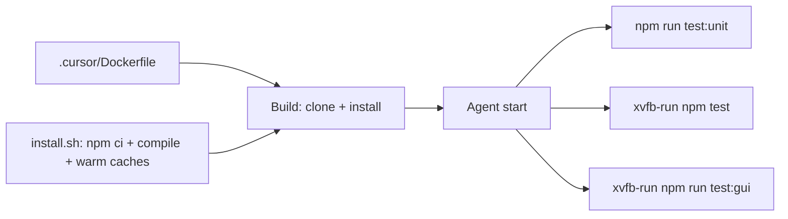

# Cloud Agent environment for this VS Code extension

The committed [`.cursor/environment.json`](.cursor/environment.json) is not a usable Cloud Agent setup:

- `snapshot-20260113-...` is a dashboard VM snapshot from 2026-01-13. Snapshots expire after 30 days of inactivity and are not portable across users.
- `start` is `npm run compile`. Cursor runs `start` on every agent boot for long-lived processes (Docker, DBs). Compile belongs in `install`, which runs during Builds and is snapshotted.
- Host/GUI tests need Linux Electron/GTK/xvfb (and Chromium for WDIO). The default Cloud image does not guarantee those.

Cursor Cloud Agents are Ubuntu VMs. This repo is a TypeScript VS Code extension (Node **23.9.0** in [`.nvmrc`](.nvmrc), lockfile present, `npm run compile` → `out/`). Tests are documented in [`src/test/README.md`](src/test/README.md).



## 1. Rewrite [`.cursor/environment.json`](.cursor/environment.json)

Drop `snapshot`, `start`, and empty `terminals`. Use a Dockerfile base and an idempotent install script:

```json
{
  "name": "pho-jupyter-cell-tags",
  "build": {
    "dockerfile": "Dockerfile",
    "context": ".."
  },
  "install": "bash .cursor/install.sh"
}
```

- `dockerfile` / `context` are relative to `.cursor/` (`Dockerfile` + `..` = [`.cursor/Dockerfile`](.cursor/Dockerfile) built with repo root as context).
- Do **not** `COPY` the project in the Dockerfile; Cursor clones the requested commit, then runs `install` from the project root.
- No `start` / `terminals`: there is no always-on server. Agents compile/test on demand.
- `enable_testing` stays default `true` so computer-use can drive a VS Code window if needed.

After this lands on the default branch, the Cloud Agents dashboard environment must point at this file (new environments default to location **None** and skip it). Then trigger a Build.

## 2. Add [`.cursor/Dockerfile`](.cursor/Dockerfile)

Debian/Ubuntu base (required for computer-use). Pin Node to `.nvmrc` (**23.9.0**). Install Electron/VS Code runtime libs, xvfb, Chromium, and git. Follow Cursor’s convention: `USER ubuntu` and `WORKDIR /home/ubuntu`. Do not copy source.

Expected packages: `xvfb`, `libgtk-3-0`, `libnss3`, `libgbm1`, `libasound2`, `libatk-bridge2.0-0`, `libdrm2`, `libxkbcommon0`, `libxcomposite1`, `libxdamage1`, `libxrandr2`, `libcups2`, `chromium`, `ca-certificates`, `curl`, `git`, `unzip`.

Install Node 23.9.0 from the official tarball (or NodeSource) so `node`/`npm` match local, then drop privileges to `ubuntu`.

## 3. Add [`.cursor/install.sh`](.cursor/install.sh)

Idempotent Build script (must tolerate re-runs on existing disk):

1. `npm ci` (lockfile is committed)
2. `npm run compile`
3. Warm `@vscode/test-electron` into `/tmp/pho-jct/vscode` (same cache path [`src/test/runTest.ts`](src/test/runTest.ts) uses)
4. Install `ms-toolsai.jupyter` and `ms-toolsai.jupyter-renderers` into `~/.vscode/extensions` (Open VSX vsix unzip). Host/GUI runners currently **copy** those from `~/.vscode/extensions` and skip if missing.

Do not start xvfb or VS Code here. Builds keep disk only; processes do not survive into the agent run.

## 4. Add root [`AGENTS.md`](AGENTS.md)

Short project context plus a **Cursor Cloud specific instructions** section (Cursor’s recommended heading):

- This is a VS Code extension, not a web app. Commands: `npm run compile`, `npm run test:unit`, `xvfb-run -a npm test`, `xvfb-run -a npm run test:gui`, `npm run package`.
- Prefer `test:unit` for fast verification; use `npm test` for the command matrix; GUI smokes are slower and need a display.
- Kernel execution tests stay off unless `JUPYTER_CELL_TAGS_KERNEL_TESTS=1` and a Python kernel exist (do not install a kernel in v1).
- Host/GUI launchers junction the repo under `$TMPDIR/pho-jct` because the Windows path has a space; on Linux Node ignores `'junction'` and creates a normal symlink.
- Do not publish a VSIX or commit secrets. Marketplace tokens, if any, belong in the Cloud Agents Secrets tab, not in the repo.

## Out of scope

- Changing host/GUI test code unless Linux install proves `copyLocalExtension` is insufficient.
- Python/ipykernel for kernel tests.
- Repo `.cursor/rules` or skills.
- Dashboard secret values (none required to compile or run unit/host tests).
