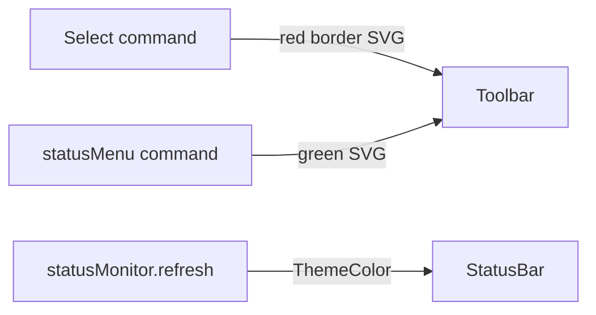

# Durable Kernel Button Visibility

## Constraint

Notebook toolbar buttons from `package.json` cannot use CSS borders or `ThemeColor`. The reliable way to get a **green / red** look is **custom SVG command icons** (fixed colors that stay visible on both light and dark toolbars).

Existing toggle already maps to the two states we care about in [`package.json`](package.json):

| State | Command | Current icon |
|-------|---------|--------------|
| Not active | `selectKernel` | `$(vm)` (low contrast) |
| In use | `statusMenu` | `$(server-environment)` (low contrast) |

## Approach



### 1. Add icons under `media/`

Create two 16×16 SVGs (1px padding, centered):

- [`media/durable-kernel-inactive.svg`](media/durable-kernel-inactive.svg) — compact server/vm glyph inside a **red rounded-rect stroke** (`#e11d48` or similar) so “not active” reads as a bordered control.
- [`media/durable-kernel-active.svg`](media/durable-kernel-active.svg) — same glyph with a **green filled badge/dot or green stroke+fill** (`#16a34a`) so “in use” is obvious at a glance.

Use the same asset for light and dark paths (saturated traffic-light colors read on both).

### 2. Wire icons in [`package.json`](package.json)

```json
"jupyter-cell-tags.externalKernel.selectKernel": {
  "icon": {
    "light": "media/durable-kernel-inactive.svg",
    "dark": "media/durable-kernel-inactive.svg"
  }
},
"jupyter-cell-tags.externalKernel.statusMenu": {
  "icon": {
    "light": "media/durable-kernel-active.svg",
    "dark": "media/durable-kernel-active.svg"
  }
}
```

No when-clause changes; the existing Select ↔ Durable swap already drives which icon appears.

### 3. Mirror state on the status bar in [`src/externalKernel/statusMonitor.ts`](src/externalKernel/statusMonitor.ts)

In `refresh()`, after computing health / kernel attachment:

- Durable server present and health `up` → `statusBar.color = new ThemeColor('charts.green')`, clear `backgroundColor`.
- Health `down` or unknown → `statusBar.color = new ThemeColor('errorForeground')` and `backgroundColor = new ThemeColor('statusBarItem.errorBackground')` (cleared when healthy again).

This reinforces the same green/red language next to the toolbar without depending on SVG packing for the status bar.

### 4. Packaging

Confirm `media/**` is not excluded by [`.vscodeignore`](.vscodeignore) (add an allow rule only if needed) so the VSIX/debug host can load the icons.

## Manual check

- No durable / not in-use: right toolbar shows Select with **red-bordered** icon.
- Durable running + kernel attached: icon swaps to **green** Durable control.
- Status bar text tint follows green when healthy, error styling when down.
