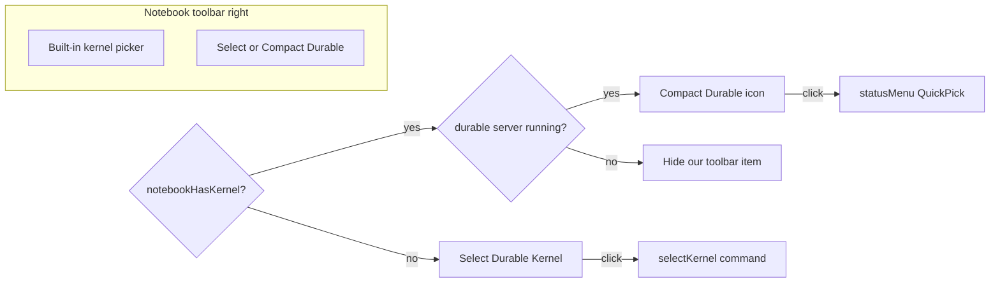

# Durable Kernel Toolbar Placement

## Problem

[`package.json`](package.json) currently contributes Select Durable Kernel on the **left** execute strip:

```1138:1142:package.json
{
  "command": "jupyter-cell-tags.externalKernel.selectKernel",
  "group": "navigation/execute@10",
  "when": "notebookType == jupyter-notebook && config.jupyter-cell-tags.features.durableKernel"
}
```

VS Code’s notebook global toolbar renders `navigation*` groups on the left and `status*` on the right. The built-in kernel picker uses `group: 'status'` (order `-10`), so our button never sits next to it. Nothing hides or replaces the button after a kernel is attached.

## Approach



**Chosen UX (locked):**
1. Place our control in `status` next to the kernel picker (far right).
2. Before a kernel is attached → show **Select Durable Kernel…**.
3. After a kernel is attached and a durable server is registered → replace with a **compact** toolbar button (icon + short title) that runs `statusMenu` (same QuickPick as the status bar).
4. After a kernel is attached but no durable server → show nothing from us (built-in kernel picker is enough).
5. Keep the existing bottom status bar as-is for the full dynamic label (`Durable :port idle`).

Detection uses Jupyter’s `kernels.getKernel(uri)` (already used in [`statusMonitor.ts`](src/externalKernel/statusMonitor.ts)): a non-undefined kernel means “a kernel has been selected/started” for the active notebook. Perfect “this is *our* durable session” attribution is not exposed by the public Jupyter API; pairing `notebookHasKernel` with `externalKernel.running` is the practical signal for when to show the compact Durable control.

## Changes

### 1. `package.json` — toolbar + compact command presentation

- Move Select contribution from `navigation/execute@10` to **`status@-9`** (kernel picker is `status` order `-10`; `-9` places us immediately beside it on the right).
- When for Select:
  - `notebookType == jupyter-notebook && config.jupyter-cell-tags.features.durableKernel && !jupyter-cell-tags.externalKernel.notebookHasKernel`
- Add toolbar entry for `jupyter-cell-tags.externalKernel.statusMenu`:
  - `group`: `status@-9`
  - `when`: notebook + feature + `jupyter-cell-tags.externalKernel.notebookHasKernel && jupyter-cell-tags.externalKernel.running`
- Give `statusMenu` an **icon** (e.g. `$(server-environment)`) and a short **title** / `shortTitle` such as `Durable` so the toolbar control stays narrow (labels still depend on `notebook.globalToolbarShowLabel`).

### 2. [`src/externalKernel/statusMonitor.ts`](src/externalKernel/statusMonitor.ts) — context key

In `refresh()` (already polls health and resolves kernel status):

- Set `jupyter-cell-tags.externalKernel.notebookHasKernel` via `setContext` to whether `getKernel(activeNotebook.uri)` returned a kernel.
- Clear it when there is no active notebook editor.
- Reuse the existing kernel listener path so busy/idle changes keep the context accurate after attach/detach.

`jupyter-cell-tags.externalKernel.running` is already maintained in [`DurableServerManager.syncContextKeys()`](src/externalKernel/DurableServerManager.ts).

### 3. No handler rewrites required

[`startup.ts`](src/externalKernel/startup.ts) already registers `selectKernel` and `statusMenu`. Toolbar only needs the contribution + when-clause toggle (same pattern as notebook filter set/clear at `@9`).

## Manual check

- Open a Jupyter notebook with durableKernel enabled: Select appears on the **right**, next to Select Kernel.
- Select a kernel (durable or otherwise): Select disappears.
- With a durable server registered and a kernel attached: compact **Durable** control appears in the same spot; click opens the status QuickPick.
- Switch to a notebook with no kernel: Select returns.