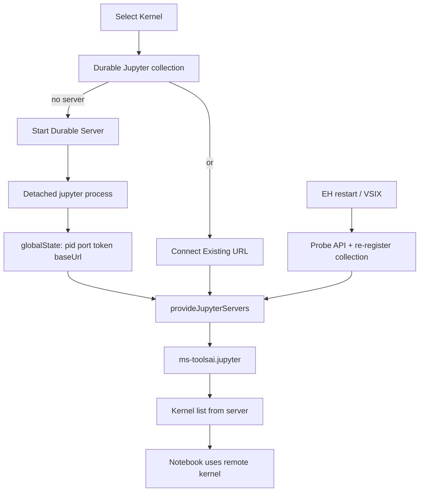

# Durable External Jupyter Kernels

## Goal

Make “keep kernel state across VSIX / Restart Extensions” a first-class workflow: **one managed local Jupyter server that outlives the Extension Host**, selectable from the same Kernel Picker path as built-in kernels, with start / connect / monitor / stop.

Default locked in: **detached process managed by this extension** (not terminal-only, not “user starts Jupyter themselves”). Connect-to-existing-URL is included as a secondary path.

## Why this API

Microsoft’s stable Jupyter API already supports this exact UX:

- [`createJupyterServerCollection`](https://github.com/microsoft/vscode-jupyter/blob/main/src/api.d.ts) → entry in **Select Kernel**
- `JupyterServerProvider` → list running durable / connected servers
- `commandProvider` → **Start Durable Server** / **Connect to URL…** inside that picker (same pattern as [jupyter-server-provider-sample](https://github.com/microsoft/vscode-extension-samples/tree/main/jupyter-server-provider-sample))

Do **not** use deprecated `jupyter.selectjupyteruri`. Do **not** implement a custom `NotebookController`; keep cell execution on `ms-toolsai.jupyter`.



## New module: `src/externalKernel/`

| File | Role |
|------|------|
| [`DurableServerManager.ts`](src/externalKernel/DurableServerManager.ts) | Spawn/stop, persist/rehydrate, HTTP health, events |
| [`jupyterServerCollection.ts`](src/externalKernel/jupyterServerCollection.ts) | Wire `createJupyterServerCollection` + providers |
| [`statusMonitor.ts`](src/externalKernel/statusMonitor.ts) | Status bar + Output channel |
| [`startup.ts`](src/externalKernel/startup.ts) | Activate, register commands, lazy Jupyter activate on notebook open |

Wire from [`src/extension.ts`](src/extension.ts) next to other feature startups: `activateExternalKernel(context)`.

### Spawn (durable)

- Python from existing setting [`jupyter-cell-tags.jupyterEnhancements.kernel.pythonPath`](package.json) (fallback: `python` on PATH).
- Command shape:  
  `python -m jupyter notebook --no-browser --port=<port> --NotebookApp.token=<token> --NotebookApp.password=''`  
  (equivalent `jupyter_server` flags if notebook entrypoint fails — try notebook first, then server).
- `child_process.spawn` with `detached: true`, `windowsHide: true`, cwd = workspace folder (or first folder), stdout/stderr → log file under `context.globalStorageUri`.
- `child.unref()` so the process survives EH death.
- Generate a random token; prefer an open port (try configured default, else ephemeral).
- Wait until `GET {baseUrl}/api/status` succeeds (Authorization via token query/header) before advertising the server.

### Persist / rehydrate (EH restart)

Store in `context.globalState` key e.g. `externalKernel.durableServer`:

```ts
{ pid, port, token, baseUrl, workspaceKey, logPath, startedAt }
```

On activate (or first notebook open):

1. If record exists → HTTP probe; if alive, keep and fire `onDidChangeServers`.
2. If dead → clear record (do not leave stale picker entries).
3. **Never** kill the process on extension `deactivate` — only on explicit **Stop**.

### Kernel Picker (same workflow as internal)

On first notebook open (per Jupyter API guidance — avoid activating Jupyter at cold startup unless needed):

```ts
const jupyter = await activateMsJupyter();
const collection = jupyter.createJupyterServerCollection(
  'jupyter-cell-tags.durable',
  'Durable Jupyter (survives reload)',
  serverProvider
);
collection.commandProvider = {
  provideCommands: () => [
    { label: 'Start Durable Server', canBeAutoSelected: true },
    { label: 'Connect to Existing Server URL…' },
  ],
  handleCommand: async (cmd) => { /* start or prompt URL → return JupyterServer */ },
};
```

`provideJupyterServers` returns the managed/connected server(s) with eager `connectionInformation: { baseUrl, token }`.

User path matches internal kernels: **Select Kernel → Durable Jupyter… → Start (or pick running) → pick Python kernel → run cells**. Variables survive **Restart Extension Host** because the server PID stays up and Jupyter reconnects.

### Connect (secondary)

Command + picker command: prompt for base URL (+ optional token), validate `/api/status`, add to the same collection (tracked separately from the spawned server so Stop only kills what we spawned).

### Monitor

- **Status bar** (right side, notebook-relevant):  
  `$(server-environment) Durable :8888` with tooltip: URL, PID, last health, and if active notebook has a kernel via `api.kernels.getKernel(uri)` → show `idle`/`busy` from `Kernel.status`.
- Click → QuickPick: Copy URL, Show log, Stop, Start, Connect…
- **Output channel** `Durable Jupyter`: spawn lines, health failures, stop events.
- Lightweight poll (~5s) of `/api/status` while a notebook is open or a durable server is registered.

### Commands + package.json

Contribute under category **Durable Jupyter**:

- `jupyter-cell-tags.externalKernel.start`
- `jupyter-cell-tags.externalKernel.stop` (`when` server managed/running)
- `jupyter-cell-tags.externalKernel.connect`
- `jupyter-cell-tags.externalKernel.copyUrl`
- `jupyter-cell-tags.externalKernel.showLog`

Settings (new, under `jupyter-cell-tags.externalKernel.*`):

- `defaultPort` (number, `0` = auto)
- `autoRegisterOnNotebookOpen` (boolean, default `true`) — registers the collection when a notebook opens
- Reuse `jupyterEnhancements.kernel.pythonPath` for the executable (document in setting description)

Activation: `onNotebook:jupyter-notebook` already present; add `onCommand:` for the new commands.

Optional notebook toolbar icon in `navigation` group: **Start/Show Durable Kernel** → starts if needed then `notebook.selectKernel` so the Durable collection is one click away. Keep this thin; picker remains source of truth.

## Out of scope (v1)

- Remote JupyterHub / Azure ML providers
- Replacing Microsoft’s local “start kernel for me” path
- Auto-forcing kernel selection by opaque kernel id (fragile per jupyter#15188); user still picks a kernel once from our server
- Fixing the unrelated `jupyter-cell-tags.listKernels` vs `jupyterKernelExecution.listKernels` ID mismatch (separate cleanup)

## Verification

1. Start Durable Server from Kernel Picker → run a cell that defines `x = 1`.
2. **Developer: Restart Extension Host** → status bar rehydrates; reconnect / reselect Durable kernel if needed → `x` still defined.
3. Stop from command → process gone; picker no longer lists it; status bar clears.
4. Connect to a manually started `jupyter notebook` URL → appears in same collection; Stop does **not** kill that process.
5. Install VSIX + Restart Extensions with durable server running → same reconnect story as (2).
