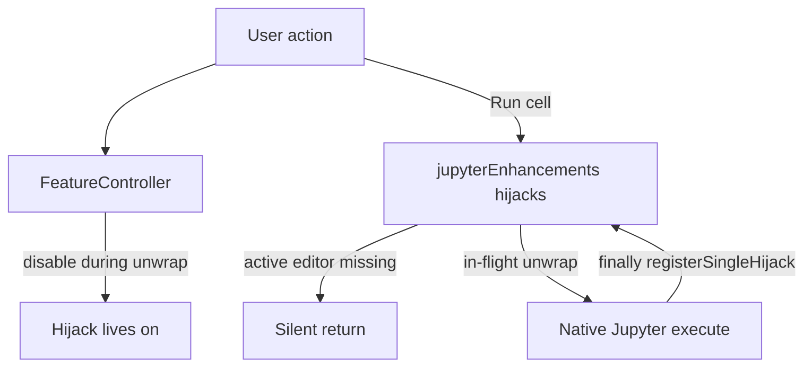

# Feature reliability review

Audit of always-on core plus every `features.*` module after live hot-toggle. Findings are ranked by **user-visible damage** (swallowed execute, wrong-notebook edits, kernel orphans, caret/outline fights), not by code volume.

## Already in good shape

- [`FeatureController`](src/util/featureLifecycle.ts) serializes enable/disable so command IDs are not double-registered.
- Filter disable **awaits** `clearAll`; durable kernel **does not** kill the spawned process on toggle-off.
- Cell-history dispose cancels timers without flushing `applyEdit`.
- Execute-tracking **commands** stay registered (Shift+Enter always forwards); only the listener/view is gated.
- Scrollbar decorators already attach/detach their own hot listeners.

## P0 — Execute and kernel (can look like “Run does nothing”)

These only apply when `features.jupyterEnhancements` is on (package.json default is **false**; `FEATURE_DEFAULTS` says **true** — see P3).

1. **Hijack resurrects after toggle-off.** [`withNativeCellExecute`](src/jupyterEnhancements/extension.ts) `finally` always calls `registerSingleHijack()`. If the user disables the feature mid-run, child dispose + `deactivateJupyterEnhancements` drop the hijack, then `finally` re-registers `notebook.cell.execute` **outside** the child context. Fix: a generation/`enabled` flag; `finally` re-registers only if still live. Drain or abort `executeGate` on disable.

2. **Hijacked run no-ops without `activeNotebookEditor`.** [`runSingleHandler`](src/jupyterEnhancements/extension.ts) / `runSequenceHandler` return if there is no active editor, even when `args` carry `ranges` / `notebookUri` / a `NotebookCell`. Native Jupyter often invokes execute that way. Fix: resolve the notebook from `args` first; only then fall back to the active editor. If still unresolved, forward to native execute instead of returning.

3. **Swallowed activate still marked live.** [`extension.ts`](src/extension.ts) `jupyterEnhancements` / `durableKernel` `activate` catch errors and do not rethrow, so [`FeatureController.enable`](src/util/featureLifecycle.ts) always `live.add`. Fix: rethrow after log, or return a failed signal.

4. **Module maps survive disable.** `deactivateJupyterEnhancements` does not clear `cellStatusMap`, scratchpad maps, `executeGate` waiters, or the extra output channel. Re-enable shows stale borders/scratchpads. Clear them in `deactivateJupyterEnhancements`.

## P1 — Data integrity (wrong notebook / lost collapse / stale git)

5. **Tags commands after dialogs.** [`allNotebookTagsTreeDataProvider.ts`](src/noteAllTags/allNotebookTagsTreeDataProvider.ts) captures `editor`, `await`s input, then `applyEdit` without re-checking URI. Same class of bug as git `selectModifiedCell` using only `activeNotebookEditor`. Fix: snapshot `notebook.uri` (and cell index) before `await`; abort if the notebook is closed or no longer active.

6. **Filter clear over-expands.** [`NotebookFilterManager.apply`](src/notebookFilter/NotebookFilterManager.ts) records **every** non-match in `collapsedByFilter`. `clear()` expands all of them, including cells the user had collapsed before filtering. Fix: only record indices that were **not** already collapsed at apply time; expand only those.

7. **Git highlighter ignores notebook edits.** [`gitDiffProvider.ts`](src/gitDiff/gitDiffProvider.ts) fills `cellStatusMap` once; the tree refreshes on document change, the highlighter does not. Insert/delete/reorder paints the wrong cells. Subscribe with the same content/metadata filter as the tree, or clear highlights on structural change.

8. **Cell history keyed by index.** [`cellHistoryTracking.ts`](src/cellHistory/cellHistoryTracking.ts) debounce key is `uri#index` plus a stored `NotebookCell`. Insert/delete before flush can stamp `cellEdited` on the wrong cell. Key by `cell.document.uri` instead of index.

9. **Missing `cellIndex` bounds** on custom-outline `selectCell` and tags `openNotebookCell` / `executeRunCell`. Guard `0 <= index < cellCount`.

## P2 — Interactive reliability (outline, arrows, logging)

These match the in-cell Up/Down lag and “outline steals focus” reports.

10. **Custom outline selection always `syncOutline`.** [`customOutline/startup.ts`](src/customOutline/startup.ts) `onDidChangeSelection` calls `outlineSyncManager.syncOutline` → `workbench.action.focusActiveEditorGroup`. Clicks yank focus; can drop insert mode. Gate: only sync when the change is from a click/command, never on reveal-driven selection.

11. **Visible-range updates are not debounced** (`onDidChangeNotebookEditorVisibleRanges` → per-item `onDidChangeTreeData`). Debounce/coalesce to one tree event; skip when the outline view is hidden.

12. **Refresh rebuilds new `OutlineItem` instances** with no `TreeItem.id`. Collapse state resets; `currentSection === bestMatch` fails; extra `reveal({ expand: true })`. Add stable ids (`cellIndex:level:line`); reveal without expand if already visible.

13. **`log()` always writes PhoLogger.** [`SelectionChangeDetector`](src/outlineSync/SelectionChangeDetector.ts) logs every cell selection. Gate `appendLine` on `debugPrint` the same way as `console.log`.

14. **Git / filter / chain `onDidChangeVisibleTextEditors`** with no debounce and git restore even when `cellStatusMap` is empty. Skip no-op restores; debounce like jupyterEnhancements (100ms).

15. **`UpdateCoordinator` visibility listener** is not on `context.subscriptions`. Push it so customOutline disable actually drops it.

## P3 — Defaults, always-on core, tests

16. **Align `FEATURE_DEFAULTS` with `package.json`:** `errorNavigation` true, `scrollbarDecorators` false, `jupyterEnhancements` false, `ringMeJupyter` false, `cellHistory` true (or change package.json — pick **package.json as source of truth** so Settings UI matches).

17. **Durable kernel:** reset `externalKernel.healthy` / `notebookHasKernel` on disable; mutex `refresh()` so 5s polls do not overlap.

18. **`updateContext` jumpback reads** while jumpbacks are off — skip `JumpbackDataSource.load*` unless the feature is live.

19. **Host tests** for P0: disable jupyterEnhancements during an in-flight unwrap (hijack must not return); execute with `args.ranges` and no active editor still runs or forwards. P1: filter clear does not expand a pre-collapsed cell (if the API exposes collapse). Keep existing hot-toggle suite.

## Out of scope for this pass

- Making run groups / headings / core tags hot-toggleable.
- Reverting jupyterEnhancements compact-layout writes to user `settings.json`.
- Stopping durable Jupyter processes on feature disable (intentional).
- Full performance rewrite of every decoration path beyond debounce/skip-empty.

## Implementation order

Do P0 first (execute correctness). Then P1 (data). Then P2 (the outline/arrow issues already diagnosed). P3 last (defaults + tests). Each phase should stay kernel-safe (no window reload).
