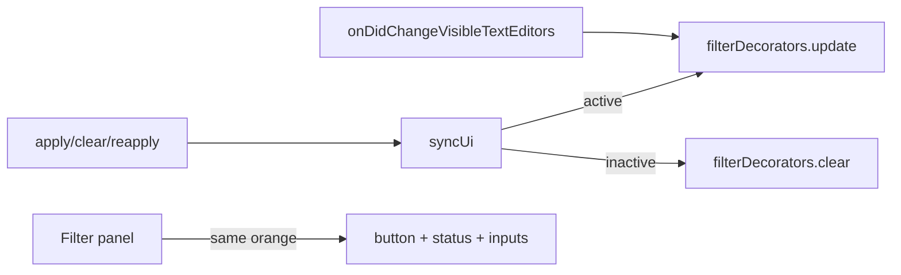

# Filter match orange decorators

## Color

Shared constant in a small module (or top of the decorator file):

```ts
export const FILTER_ACCENT = 'rgba(255, 165, 0, 0.85)'; // same orange as cellVisualHighlight
export const FILTER_ACCENT_CSS = '#ffa500';
```

Use `OverviewRulerLane.Right` so marks sit beside tag (Center) and git-diff (Left) decorations.

## Decorators

New [`src/notebookFilter/filterDecorators.ts`](src/notebookFilter/filterDecorators.ts), patterned on [`scrollbarDecorators.ts`](src/noteAllTags/scrollbarDecorators.ts):

- One `TextEditorDecorationType` with `overviewRulerColor: FILTER_ACCENT`, lane Right
- `update(notebook)`: for each match index, find the cell’s `visibleTextEditors` entry and `setDecorations` on the full document range
- `clear()`: clear decorations from visible editors and dispose/recreate type as needed
- Listen to `onDidChangeVisibleTextEditors` so newly scrolled-into-view cells get marks

## Manager: track match indices

In [`NotebookFilterManager`](src/notebookFilter/NotebookFilterManager.ts):

- Add `matchedByFilter: Set<number>` (or `number[]`) to `NotebookFilterState` (populated from `matchIndices` in `apply`)
- Expose `getMatchedIndices(notebook): number[]`
- Call decorator `update` from `syncUi` when active; `clear` when inactive / forget / dispose

Own the decorator instance in the manager (construct in constructor, dispose with manager) so apply/clear/reapply stay in one place without startup churn.

## Sidebar orange association

In [`filterWebviewProvider.ts`](src/notebookFilter/filterWebviewProvider.ts) HTML CSS:

- `--filter-accent: #ffa500` (same hue as `FILTER_ACCENT`)
- `input` accent-color → `--filter-accent`
- **Filter** primary button → orange background / dark text (instead of default VS Code blue)
- When `filterActive`, status line uses orange text; optional thin left border / accent bar on the panel when active

No new settings or package.json entries.

## Wiring

[`startup.ts`](src/notebookFilter/startup.ts): no special changes beyond existing apply/clear/refresh paths that already call `syncUi` / `postState` — decorations refresh via manager `syncUi`.



## Verification

- Apply filter → orange scrollbar ticks on matching cells; Filter button/status orange in sidebar
- Scroll notebook → newly visible matches get ticks
- Clear filter → ticks gone; panel accents return to inactive look
- Switch notebooks → decorations follow active notebook’s filter state