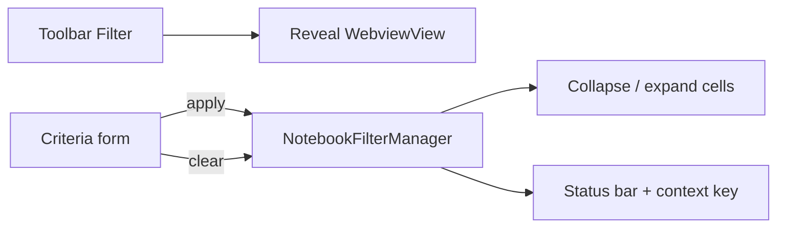

# Notebook Filter Sidebar UI

## Approach

Add an Explorer **WebviewView** (`type: "webview"`) for filter criteria. Tree views elsewhere in this repo cannot host a compact form with radios + multi-select tags + action buttons; this is the first sidebar webview, styled like the existing panel webview in [`src/cellMetadataDisplay/cellMetadataDisplay.ts`](src/cellMetadataDisplay/cellMetadataDisplay.ts) (VS Code CSS variables, inline HTML).

Keep collapse/apply logic in [`NotebookFilterManager`](src/notebookFilter/NotebookFilterManager.ts). Retire QuickPick as the primary path: toolbar/command **Filter** reveals the sidebar; **Filter** / **Clear Filter** buttons live in the webview. Keep [`filterQuickPick.ts`](src/notebookFilter/filterQuickPick.ts) unused or delete it once the webview path is wired (delete to avoid two UX paths).

## package.json contributions

In [`package.json`](package.json):

- Add explorer view:
  - `id`: `notebook-cell-filter-view`
  - `name`: `Notebook Cell Filter`
  - `type`: `webview`
  - `icon`: `$(filter)`
  - `when`: `jupyter-cell-tags.notebookActive` (same gate as Executed Cells / Dependency Chain)
- Add activation: `onView:notebook-cell-filter-view`
- Optionally add `view/title` commands that invoke the same apply/clear handlers (not required if buttons are only in the webview; **buttons will be in the webview body** as requested)
- Leave existing toolbar `notebookFilter.set` / `.clear` entries; change `set` behavior to reveal the view

## New / updated modules

| File | Role |
|------|------|
| [`src/notebookFilter/filterWebviewProvider.ts`](src/notebookFilter/filterWebviewProvider.ts) | `WebviewViewProvider`: HTML form, message protocol, tag list refresh |
| [`src/notebookFilter/startup.ts`](src/notebookFilter/startup.ts) | Register provider; `set` → `notebook-cell-filter-view.focus`; keep `clear`; push state into webview on notebook switch / apply / clear |
| [`src/notebookFilter/filterQuickPick.ts`](src/notebookFilter/filterQuickPick.ts) | Remove (replaced by webview) |

### Webview UI (single screen)

- **Tags**: checklist from active notebook tags (`getAllTagsFromActiveNotebook`), multi-select, empty = no tag constraint
- **Cell kind**: Any / Code / Markdown
- **Has outputs**: Any / Yes / No
- **Executed**: Any / Yes / No
- **Filter** button → build `NotebookFilterCriteria` → `manager.apply`
- **Clear Filter** button → `manager.clear` (enabled/styled when filter active)
- Status line: `Showing N/M` or inactive summary via `summarizeCriteria`

Theme with `--vscode-*` variables; enable scripts + CSP nonce for the message script.

### Message protocol

Extension → webview: `{ type: 'state', tags, criteria, matchCount?, totalCount?, filterActive }`  
Webview → extension: `{ type: 'apply', criteria }` | `{ type: 'clear' }`

On `onDidChangeActiveNotebookEditor`, notebook close, and after apply/clear/reapply, post updated state. Refresh available tags when the active notebook’s document changes (debounced with existing 150ms reapply path or a shared refresh).

### Command behavior

- `jupyter-cell-tags.notebookFilter.set` → `vscode.commands.executeCommand('notebook-cell-filter-view.focus')` (opens/reveals sidebar when a notebook is active)
- `jupyter-cell-tags.notebookFilter.clear` → unchanged (`manager.clear` on active notebook) + refresh webview state

## Visibility

No new context key: reuse `jupyter-cell-tags.notebookActive` already set in [`src/extension.ts`](src/extension.ts) `updateContext()`. View disappears when the active editor is not a notebook.

## Verification

- With a notebook focused, Explorer shows **Notebook Cell Filter**; switch to a `.ts` file → view hides
- Set tags + kind in the form, click **Filter** → same collapse behavior as before; status bar updates
- Click **Clear Filter** in the webview → expands filter-collapsed cells
- Toolbar filter icon focuses the sidebar; toolbar clear still clears
- Switch notebooks: form shows that notebook’s criteria / tags independently (per-URI manager state)