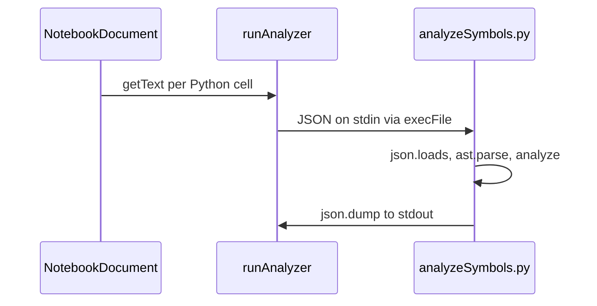

# Fix dependency chain surrogate UTF-8 error (Windows)

## Root cause

Flow today ([`src/dependencyChain/analyzeNotebook.ts`](src/dependencyChain/analyzeNotebook.ts)):

1. Cell sources are collected with `cell.document.getText()` and sent as `JSON.stringify({ cells: sources })` on stdin (line 82–111).
2. JavaScript strings may contain **unpaired UTF-16 surrogates** (e.g. `\uDC9D`). That can appear in notebook buffers from bad paste, damaged `.ipynb` JSON, or editor/internal representation edge cases—not necessarily invalid Python, but invalid for strict UTF-8.
3. Python reads the payload, runs [`analyzeSymbols.py`](src/dependencyChain/analyzeSymbols.py), then **`json.dump(..., sys.stdout)`** (line 560). On failure, `main()` writes `str(exc)` to stderr (line 562)—which matches your message: `'utf-8' codec can't encode character '\udc9d' in position 2366: surrogates not allowed`.

The configured `python.exe` path is fine; the failure is **encoding of notebook content**, not “Python not found.”

## Fix strategy (minimal, two layers)

### 1. Sanitize in TypeScript before IPC (primary)

In [`analyzeNotebook.ts`](src/dependencyChain/analyzeNotebook.ts), normalize each source string **before** pushing into `sources` and/or immediately before `JSON.stringify`:

- Add a small exported helper (e.g. `stripLoneSurrogates(text: string): string`) that replaces unpaired high/low surrogates with U+FFFD (`\uFFFD`), using the usual regex (same semantics as “safe for UTF-8 JSON over a pipe”).
- Apply it in the loop at lines 60–61 when calling `getText()`.

This keeps the notebook document unchanged; only the analyzer payload is cleaned. Symbol analysis on surrounding ASCII/Python identifiers is unaffected; only the invalid code unit is dropped from the static parse input.

### 2. Harden Python analyzer (defense in depth, helps Windows stdio)

In [`analyzeSymbols.py`](src/dependencyChain/analyzeSymbols.py):

- After `json.loads`, run the same lone-surrogate cleanup on each cell string before `analyze_cell`.
- Wrap stdin/stdout for explicit UTF-8 where needed, e.g. read from `sys.stdin.buffer` with `encoding='utf-8', errors='replace'` and write JSON to `sys.stdout.buffer` (or a UTF-8 `TextIOWrapper` with `errors='replace'`) so a future stray character cannot crash the process.

Optional but low-cost on Windows: pass `env: { ...process.env, PYTHONIOENCODING: 'utf-8' }` in `execFile` options in [`analyzeNotebook.ts`](src/dependencyChain/analyzeNotebook.ts) to avoid locale/code-page mismatches on piped I/O (separate from surrogates, but aligns with UTF-8 JSON on the wire).

## Tests

Add [`src/dependencyChain/sanitizeUnicode.test.ts`](src/dependencyChain/sanitizeUnicode.test.ts) (or colocate tests in a tiny `unicodeInterop.ts` module):

- Lone low surrogate `\uDC9D` → replaced.
- Valid surrogate pair (e.g. emoji) preserved.
- Register the file in the `test:unit` script in [`package.json`](package.json) (same pattern as [`buildChain.test.ts`](src/dependencyChain/buildChain.test.ts)).

Optional manual check: run dependency chain on the same notebook after fix; no error dialog.

## Files to touch

| File | Change |
|------|--------|
| [`src/dependencyChain/analyzeNotebook.ts`](src/dependencyChain/analyzeNotebook.ts) | Sanitize sources; optional `PYTHONIOENCODING` |
| New `src/dependencyChain/unicodeInterop.ts` (or inline helper) | Shared `stripLoneSurrogates` |
| [`src/dependencyChain/analyzeSymbols.py`](src/dependencyChain/analyzeSymbols.py) | Sanitize after load; UTF-8-safe stdout |
| [`src/dependencyChain/sanitizeUnicode.test.ts`](src/dependencyChain/sanitizeUnicode.test.ts) | Unit tests |
| [`package.json`](package.json) | Include new test in `test:unit` |

## Out of scope

- Scanning/fixing the user’s notebook on disk (they may still want to find the bad character in source for their own sanity; the fix unblocks dependency chain without editing cells).
- Changing `jupyterEnhancements.kernel.pythonPath` behavior beyond optional `PYTHONIOENCODING` for the analyzer child only.
