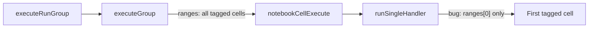

# Fix Execute Tag Run Group stopping after first cell

## Root cause

[`executeGroup`](src/notebookRunGroups/util/cellActionHelpers.ts) still correctly filters **all** cells with the selected tag and calls:

```ts
vscode.commands.executeCommand('notebook.cell.execute', { ranges: targetCells });
```

Jupyter Enhancements (enabled by default via `features.jupyterEnhancements`) **registers over** `notebook.cell.execute`. Its handler only uses the first range:

```297:300:src/jupyterEnhancements/extension.ts
	else if (args && args.ranges && args.ranges.length > 0) {
		cell = editor.notebook.cellAt(args.ranges[0].start);
	}
```

That hijack landed after tag run groups, so the feature used to work and now only runs the first tagged cell.



## Fix (chosen approach)

Update [`runSingleHandler`](src/jupyterEnhancements/extension.ts) so that when `args.ranges` is present it expands **all** cells covered by those ranges and executes them sequentially with the same per-cell path already used for single-cell / sequence runs (`withNativeCellExecute` → `executeCellAndWaitNative`, decorations, stop-on-failure).

Concrete changes in that file:

1. Resolve cells from `args.ranges` by iterating each `{ start, end }` and collecting code cells in that span (not only `ranges[0].start`).
2. If exactly one cell: keep current single-cell behavior.
3. If multiple cells: loop like `runSequenceHandler` (clear status/decoration, animate, execute+wait, `handleCellFinished`, break on failure).
4. Leave the existing `args.document` / selection fallbacks unchanged for toolbar “run cell” and scratchpad (scratchpad still passes a single one-cell range).

No change needed in [`executeGroup`](src/notebookRunGroups/util/cellActionHelpers.ts) itself — the multi-range payload is already correct.

## Verification

- Manual: notebook with 3+ cells sharing one tag → **Execute Tag Run Group** → all matching code cells run in order.
- Sanity: single-cell run button and scratchpad still run one cell.
- Optional: tree **Run Tag** (`jupyter-cell-tags.runTag`) should also work again since it calls the same `executeGroup`.
