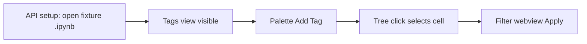

# GUI smoke suite (four workflows)

Keep the existing `@vscode/test-electron` command matrix as `npm test`. Add a **separate** GUI runner so we actually click palette / tree / webview, without trying to automate notebook cell chrome (no stable page objects).

## Stack

- **WebdriverIO v9 + `wdio-vscode-service`** (the default in [Testing VSCode Extension's GUI functionality best.md](.cursor/plans/Testing%20VSCode%20Extension's%20GUI%20functionality%20best.md)).
- Pin VS Code **stable** (same as host tests, engine `^1.98.0`).
- Install/copy `ms-toolsai.jupyter` the same way [src/test/runTest.ts](src/test/runTest.ts) does (local copy from `~/.vscode/extensions` into a no-space cache).
- Reuse the Windows **no-space junction** `%TEMP%\pho-jct` so WDIO launch args are not split on `VSCode Extensions`.
- Workspace: [src/test/workspace](src/test/workspace) (all `features.*` on) and a temp copy of [src/test/fixtures/command-matrix.ipynb](src/test/fixtures/command-matrix.ipynb).

Do **not** change [azure-pipeline.stable.yml](azure-pipeline.stable.yml). Do **not** click cell title / status-bar `+ Tag` chips.

## Layout

GUI tests stay out of the Mocha host glob (`*.vscode.test.js`):

- [wdio.conf.ts](wdio.conf.ts) at repo root (or `src/test/gui/wdio.conf.ts`)
- Specs: `src/test/gui/*.gui.ts` with a dedicated `tsconfig` so they are **not** compiled into `out/` by the extension `tsc`
- Script: `"test:gui": "wdio run src/test/gui/wdio.conf.ts"`
- Shared launch helper that junctions the repo, copies Jupyter, sets `--user-data-dir` / `--extensions-dir` under `%TEMP%\pho-jct`

API (`browser.executeWorkbench`) is allowed **only for setup**: open the fixture notebook, select a cell, read `getCellTags` / `editor.selections` for assertions. The four contracts below must go through the real UI.

## Four smokes

**1. Activation + tags view visible**

- Open fixture via workbench API.
- `all-notebook-tags-view.focus` (or Explorer sidebar + section **All Notebook Tags**).
- Wait until the tree shows `existing-tag` (fixture cells 2 and 3).

This proves activation, `when` for `all-notebook-tags-view` (`jupyter:showAllTagsExplorer && jupyter-cell-tags.notebookActive`), and that the tree indexed the notebook.

**2. Command Palette Add Tag**

- Select an untagged cell (fixture `defineX`, index 5) via API setup — required because `addTag` is gated by `jupyter-cell-tags.singleCellSelected`.
- Open the Command Palette, type `Add Tag to Cell` (contributed title `🏷️➕ Add Tag to Cell` in [package.json](package.json)).
- Confirm the Quick Pick by typing `gui-smoke-tag` and Enter (`addTag` uses `createQuickPick`, not `showInputBox`).
- Assert via workbench API that cell 5 now has `gui-smoke-tag`.

This is the only test that may use the palette. Do not stub pickers here.

**3. Tags tree click selects a cell**

- Focus `all-notebook-tags-view`, expand `existing-tag`, click the **Cell 3** / **Cell 4** child (1-based labels from [allNotebookTagsTreeDataProvider.ts](src/noteAllTags/allNotebookTagsTreeDataProvider.ts)).
- Assert `activeNotebookEditor.selections` covers fixture index 2 or 3.
- Use WDIO sidebar/tree page objects, not `executeCommand('openNotebookCell')`.

**4. Filter webview Apply**

- Focus `notebook-cell-filter-view` (Explorer webview **Notebook Cell Filter**).
- Switch into the webview iframe.
- Check the `existing-tag` checkbox, click `#applyBtn` (`Filter`).
- Assert the webview status text `Showing 2/9 cells` (two tagged cells in the 9-cell fixture) and/or that `NotebookFilterManager` collapsed the rest — prefer the visible status node.

Small production locator: add `data-testid="notebook-filter-apply"` on `#applyBtn` (and `notebook-filter-clear` on `#clearBtn`) in [filterWebviewProvider.ts](src/notebookFilter/filterWebviewProvider.ts) `getHtml`. No other UI changes.

## Reliability

- Wait for tree items / palette results / webview `#status.active`, not fixed sleeps.
- One WDIO session, four specs that share `before` notebook open.
- Timeout ~60s per spec; fail with WDIO screenshot.
- If a workbench page object cannot see a custom Explorer view, fall back to `aria-label` / section title locators documented in one `src/test/gui/workbench.ts` adapter — keep selectors out of specs.

## Docs

Update [src/test/README.md](src/test/README.md): `npm run test:gui`, what the four smokes prove vs the host matrix, and that cell toolbar/status-bar remain untested.
