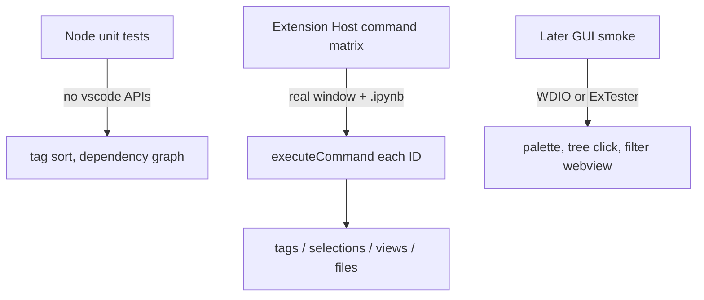

# Extension Host command matrix

The best option for **complete command coverage in a real VS Code window** is the same stack Microsoft uses for `vscode-jupyter`: **`@vscode/test-cli` + `@vscode/test-electron`**. Tests launch a real VS Code instance, install `ms-toolsai.jupyter`, open a fixture `.ipynb`, call `vscode.commands.executeCommand`, and assert notebook metadata, selections, and views.

True GUI automation (WebdriverIO / ExTester) cannot cover all ~68 commands reliably: neither ships notebook cell / cell-status-bar page objects, and this extension’s notebook UI is VS Code notebook widgets, not a webview. Palette-clicking every command would be slower, flakier, and still would not prove cell-toolbar buttons. That work stays a **later 4-workflow smoke suite**.

## Why this stack

- Already have unused [`@vscode/test-electron`](package.json) and Mocha-style files; there is **no `test` script, no mocha package, no runner**.
- `@vscode/test-cli` `installExtensions: ['ms-toolsai.jupyter']` matches [`extensionDependencies`](package.json).
- Commands talk to notebooks through `activeNotebookEditor` + `NotebookEdit` ([`src/helper.ts`](src/helper.ts)), so host tests can assert real results with `getCellTags`.
- `addTag` / `executeRunGroup` use `createQuickPick`, not `showQuickPick` ([`src/notebookRunGroups/util/cellActionHelpers.ts`](src/notebookRunGroups/util/cellActionHelpers.ts)). Host tests will stub `window.createQuickPick` / `showInputBox` / file dialogs with a fake that fires `onDidAccept`.
- Feature-gated commands are **not registered** unless the flag is on at activate ([`src/extension.ts`](src/extension.ts)). Test workspace settings must enable jumpbacks, jupyterEnhancements, cellNavigation, scrollbarDecorators, ringMeJupyter (defaults are mixed).

## Runner wiring

Add runtime test deps: `mocha`, `@vscode/test-cli`, `glob`, optionally `sinon`. Keep `@vscode/test-electron`.

Add [`.vscode-test.mjs`](.vscode-test.mjs) (same pattern as vscode-jupyter):

- Files: `out/**/*.vscode.test.js`
- `workspaceFolder`: a dedicated test workspace (not `examples/`)
- `installExtensions`: `ms-toolsai.jupyter`
- `launchArgs`: `--skip-welcome --skip-release-notes --disable-workspace-trust --enable-proposed-api=phohale.pho-vscode-jupyter-cell-tags --disable-extension=ms-toolsai.vscode-jupyter-cell-tags`
- Mocha TDD UI, 20s timeout
- Pin VS Code `stable` (engine is `^1.98.0`)

Scripts in [`package.json`](package.json):

- `"test": "vscode-test"` after `pretest` compile
- `"test:unit": "mocha out/**/*.test.js --ignore out/**/*.vscode.test.js"` for existing node-only tests ([`src/noteAllTags/tagSorting.test.ts`](src/noteAllTags/tagSorting.test.ts), [`src/dependencyChain/buildChain.test.ts`](src/dependencyChain/buildChain.test.ts), [`src/outlineSync/test/setup.test.ts`](src/outlineSync/test/setup.test.ts))

Add an **Extension Tests** launch config in [`.vscode/launch.json`](.vscode/launch.json). Do not change [`azure-pipeline.stable.yml`](azure-pipeline.stable.yml) in this pass (Microsoft publish pipeline; host tests need Jupyter + a display).

Rename the existing host tests to `*.vscode.test.ts` so they actually run:

- [`src/outlineSync/test/selectAllChildCells.integration.test.ts`](src/outlineSync/test/selectAllChildCells.integration.test.ts)
- [`src/outlineSync/test/configuration.test.ts`](src/outlineSync/test/configuration.test.ts)

Replace their “skip if no notebook is open” branches with the shared fixture opener.

## Fixture and helpers

Create a **small dedicated notebook**, not [`examples/notebooks/ReviewOfWork_TestNB.ipynb`](examples/notebooks/ReviewOfWork_TestNB.ipynb). Copy it into `os.tmpdir()` per suite so tests never dirty git.

Suggested cells in `src/test/fixtures/command-matrix.ipynb`:

- Markdown `# Heading` and `## Child`
- Code cell tagged `existing-tag`
- Code cell tagged `run-group`
- Untagged code cell
- Code cell with an error output (for error navigation)
- Two tagged cells sharing a tag (for select-all)

Helpers under `src/test/helpers/`:

- `openFixtureNotebook()` — `openNotebookDocument` + `showNotebookDocument`, wait for `activeNotebookEditor`
- `selectCells(ranges)` — set `editor.selections`
- `stubQuickPick(label)` / `stubInputBox(value)` / `stubSaveDialog(uri)` — restore in teardown
- `waitFor(predicate)` — no fixed sleeps
- `assertCellTags(cell, tags)` — uses `getCellTags`

Test workspace `settings.json` enables **all** `jupyter-cell-tags.features.*` so every `registerCommand` path runs.

## Command matrix (every contributed ID)

One registration suite plus grouped behavior suites. Each test opens the fixture, invokes the real command, asserts a causal result.

**Registration** (`registration.vscode.test.ts`): `getCommands(true)` contains every `contributes.commands` ID. This will currently fail for `jupyter-cell-tags.listKernels` (handler is registered as `jupyterKernelExecution.listKernels` in [`src/notebookRunGroups/commands.ts`](src/notebookRunGroups/commands.ts)). Include a **one-line registerCommand ID fix** so the matrix can invoke the contributed command.

**Tags / metadata** (no kernel):

- `paramaterize` — cell gets `parameters`
- `removeTag(cell, 'existing-tag')` — tag gone
- `addTag` / `addTagsToSelectedCells` — stub Quick Pick, assert `getCellTags`
- `editTagsInJSON` — a text document opens on the notebook URI
- `selectAllChildCells('existing-tag')` / `selectAllCellsUnderTag` — `editor.selections` cover tagged cells
- `renameTag` / `setTagColor` / `clearTagColor` / `setTagPriority` / `changeSortOrder` / `removeTagFromAllCells` — stub input/pick, assert notebook metadata / remaining tags
- `exportTags` / `importTags` — stub save/open dialog, assert JSON file round-trip

**Headings / outline / jumpbacks / nav / filter:**

- heading select/delete/increase/decrease depth — markdown source or selection changes
- custom outline select / select-children / delete / filter / clearFilter / show — stub filter input; assert selection or cell count
- jumpbacks add/remove/open/show/refresh — notebook jumpback metadata
- `navigateUpToPreviousErrorCell` / `navigateDownToNextErrorCell` — active cell moves to the error fixture cell
- `showNavigationMenu` — stub Quick Pick only (assert no throw + optional selection)
- `notebookFilter.set` — command does not throw (it only focuses the webview)
- `notebookFilter.clear` — after applying filter via `NotebookFilterManager` if exported, clear restores cells
- `showAllNotebookTags` / `refreshEntry` / `openNotebookCell(n)` / `toggleCellMetadataDisplay` / `ringMeJupyter.toggleBell` — no throw; metadata panel / context where observable

**Git / dependency / durable kernel (non-destructive):**

- `gitDiff.clearHighlights` / `refreshModifiedCells` / `selectModifiedCell` — no throw; select only if the tree has an item
- `gitDiff.highlightChangedCells` / `vsHead` — skip unless the temp workspace is a git repo (optional mini git init in that suite)
- `dependencyChain.showDependentCells` / `selectChain` / `revealCell` / `clearHighlights` — use a two-cell `x = 1` / `print(x)` fixture
- `externalKernel.copyUrl` / `showLog` / `statusMenu` — stub pick; **do not** start a real Jupyter server in the default suite
- `externalKernel.start/stop/connect/selectKernel` — skip unless `JUPYTER_CELL_TAGS_KERNEL_TESTS=1`

**Execution (kernel required, skip by default):**

- `executeRunCell`, `runTag`, `executeRunGroup` (stub pick then would execute)
- `executeAndSelectBelowWithTracking`, `executeAndFocusContainerWithTracking`
- `jupyterEnhancements.execute`, `runInScratchpad`
- `listExecutedNotebookCells`, `createAndAddTagToAllExecutedCells`, `navigateToPrevious/NextExecutedCell`, `exportExecutedCodeToPython`

These skip with a clear message when no kernel is selected. Do not require Python in the default `npm test`.

**Hidden / tree-click commands** still get `executeCommand` with the args the tree would pass (`cellIndex`, `tagName`, outline item shape).

## What this does *not* prove (phase 2)

Leave unimplemented now; document in `src/test/README.md`:

- Command Palette titles / `when` clauses
- `notebook/cell/title` and notebook toolbar buttons
- Cell status-bar `+ Tag` chips
- Filter webview Apply click
- Tree item context menus

Four later GUI smokes (WDIO or ExTester): activation + tags view visible; palette Add Tag; tree click selects cells; filter webview apply.

## Implementation order

1. Runner + fixture + helpers + registration suite (includes `listKernels` ID fix).
2. Tag/selection/heading suites (highest value, no kernel).
3. Feature suites: outline, jumpbacks, filter, git, dependency, durable-kernel smoke.
4. Wire existing outlineSync tests onto the fixture.
5. README with `npm test` / `npm run test:unit` and the kernel env var.
