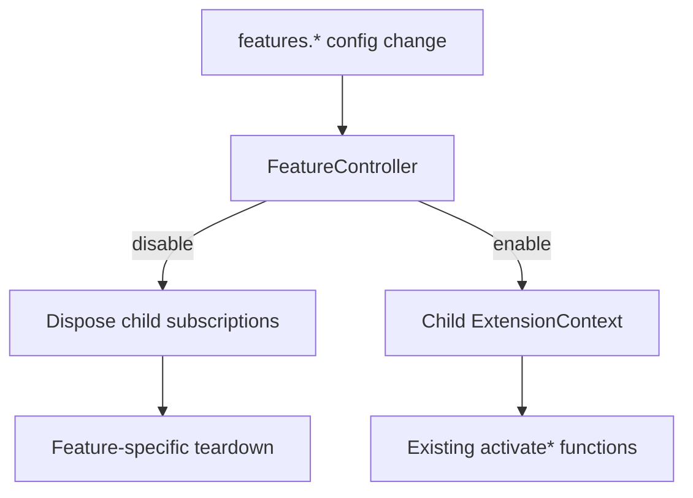

# Hot-toggle features without reload

VS Code already allows unregistering commands, tree views, and listeners by disposing them. This extension never did that: [`src/extension.ts`](src/extension.ts) calls each `activate*` once, everything lands on `context.subscriptions`, and [`registerFeatureReloadPrompt`](src/util/featureFlags.ts) asks for a window reload. The kernel dies with the host.

Copy the pattern that already works for scrollbar decorators ([`ScrollbarDecoratorManager.syncEnabledState`](src/noteAllTags/scrollbarDecorators.ts)): attach on enable, dispose on disable, re-attach on re-enable.

## Controller

Add [`src/util/featureLifecycle.ts`](src/util/featureLifecycle.ts):

- `createFeatureContext(parent)`: an `ExtensionContext` whose `subscriptions` is a **private array**. Existing `activate*` functions keep `context.subscriptions.push(...)` and do not need a signature change.
- `FeatureController` maps each `FeatureKey` to `{ activate, onDispose? }`, tracks which features are live, and serializes toggles on a promise chain so rapid Settings flips cannot double-register a command id.
- On `onDidChangeConfiguration` for `jupyter-cell-tags.features`, sync each key. No UI prompt. Never call `workbench.action.reloadWindow`.

Replace `registerFeatureReloadPrompt` with `registerFeatureHotToggle`. Delete `RELOAD_REQUIRED_FEATURES`.

Wire it from [`src/extension.ts`](src/extension.ts): always-on core stays on the real `context` (tags, run groups, headings, navigation menu, execution **command** wrappers, status bar, `updateContext` listeners). Optional modules go through the controller, which calls the same activate functions they use today if the flag is on at startup.

## Per-feature activate / disable

| Feature | Enable | Disable must also |
|---|---|---|
| jumpbacks | existing register* calls | clear jumpback debounce timer; `setJumpbackExtensionContext(undefined)` |
| outlineSync | `activateOutlineSync` | `SelectionChangeDetector`/`OutlineSyncManager.dispose`; set [`syncManager`/`selectionDetector`](src/outlineSync/startup.ts) to `undefined` |
| customOutline | `registerCustomOutline` | cancel `UpdateCoordinator` timers; dispose tree view. Call `getSelectionDetector()` **lazily** so outlineSync can toggle independently ([`customOutline/startup.ts`](src/customOutline/startup.ts) currently captures them once) |
| jupyterEnhancements | `activateJupyterEnhancementsModule` | existing `deactivateJupyterEnhancements()` (un-hijack `notebook.cell.execute` / `notebook.execute`, drop decorations/animations). Do **not** revert global notebook layout settings the module may have written |
| gitDiff | `activateGitDiffHighlighting` | `highlighter.dispose()` already clears decorations + status bar |
| dependencyChain | `activateDependencyChain` | `clearDecorations()` |
| notebookFilter | `activateNotebookFilter` | **await** `NotebookFilterManager.clearAll()` so collapsed cells expand. Today [`dispose()`](src/notebookFilter/NotebookFilterManager.ts) fires `clearAll` without awaiting — change it to return `Promise<void>` so the controller can wait before re-enable |
| ringMeJupyter | `activateRingMeJupyter` | disposing the notebook listener + status-bar provider is enough |
| durableKernel | `activateExternalKernel` | dispose collection, monitor, commands. **Do not** `stopManaged()` — [`DurableServerManager.dispose`](src/externalKernel/DurableServerManager.ts) already leaves the process running. Re-enable rehydrates via `initialize()` |
| cellHistory | `activateCellHistoryTracking` | cancel pending 1.5s timers **without** `applyEdit` (current dispose flushes `cellEdited` and would dirty the notebook on toggle) |
| cellExecutionTracking | only `activateNotebookCellExecutionTracking` (listener + executed-cells view) | Shift+Enter wrappers stay always registered and already no-op when the flag is off |
| errorNavigation | no dedicated activate | add `isFeatureEnabled('errorNavigation')` guards in the two navigate handlers (commands stay registered; package.json `when` already hides UI) |
| scrollbarDecorators | unchanged, already hot-toggles inside the always-on tags view | — |

**outlineSync duplication:** [`registerAllNotebookTagsView`](src/noteAllTags/allNotebookTagsTreeDataProvider.ts) constructs a second `OutlineSyncManager` (lines 301–317, used ~630). Point that path at `getSyncManager()` so tags-tree sync dies with the outlineSync feature instead of living forever.

**F11 scratchpad:** [`package.json`](package.json) keybinding `jupyter-cell-tags.jupyterEnhancements.runInScratchpad` is not feature-gated. After unregistering that command, F11 would be “command not found”. Add `config.jupyter-cell-tags.features.jupyterEnhancements` to its `when` clause.

## Module nits so child-context dispose is complete

- [`outlineSync/startup.ts`](src/outlineSync/startup.ts): push a disposable that nulls the module globals.
- [`customOutline/startup.ts`](src/customOutline/startup.ts): push `{ dispose: () => updateCoordinator.cancelPendingUpdates() }`; drop the early `if (!enabled) return` (controller will not call it when off); stop treating `features.customOutline` config changes as a mini-toggle (controller owns that).
- [`cellHistory/cellHistoryTracking.ts`](src/cellHistory/cellHistoryTracking.ts): dispose = `clearTimeout` only.
- [`jupyterEnhancements/extension.ts`](src/jupyterEnhancements/extension.ts): `deactivateJupyterEnhancements` must also clear the visible-editor scroll timeout.

## Tests

Host test [`src/test/commands/featureToggle.vscode.test.ts`](src/test/commands/featureToggle.vscode.test.ts) (restore workspace settings in teardown):

1. Toggle `features.customOutline` off then on; `customOutline.show` / `selectCell` still works (proves dispose + re-register does not throw duplicate-id).
2. Toggle `features.jumpbacks` off; `executeCommand('jupyter-cell-tags.addJumpback')` fails; on again, addJumpback works.
3. Apply a notebook filter, toggle `features.notebookFilter` off, assert cells are expanded again.

Unit-test the controller with fake activators if it stays easy to inject; do not mock all of vscode.

Existing host suites keep all flags on in [`src/test/workspace/.vscode/settings.json`](src/test/workspace/.vscode/settings.json); they should still pass.

After TypeScript changes: `npm run test:unit`, then `npm test` for the host matrix.

## Out of scope

- Making core tagging / run groups / headings toggleable.
- Adding `cellNavigation` to `FeatureKey` (toolbar `when` already hides it; no EH listeners).
- Stopping a durable Jupyter process when the feature is turned off.
- Reverting jupyterEnhancements compact-layout writes to user `settings.json`.
