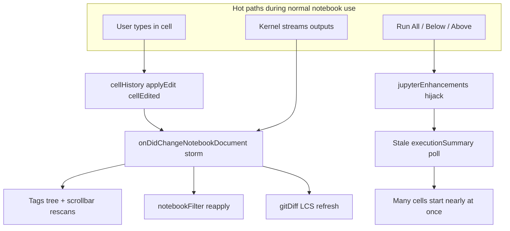

# Extension performance & kernel stability review

Review covered activation wiring in [`src/extension.ts`](src/extension.ts), feature defaults in [`src/util/featureFlags.ts`](src/util/featureFlags.ts), and hot paths that execute cells, mutate notebooks, or manage external Jupyter processes. Findings below are ranked by likelihood of disrupting **running kernels** or **editor responsiveness**.



---

## Critical — can disrupt kernels or freeze the editor

### 1. Stale `executionSummary` races sequential multi-cell runs
**Where:** [`src/jupyterEnhancements/extension.ts`](src/jupyterEnhancements/extension.ts) — `executeCellAndWaitNative` (~362–390), used by `runSequenceHandler`  
**Default on:** `features.jupyterEnhancements: true`

Poller resolves as soon as `cell.executionSummary?.success !== undefined`. That field is often **already set from a prior run**, so the waiter can finish before the new execution starts.

```371:376:src/jupyterEnhancements/extension.ts
		const poller = setInterval(() => {
			if (cell.executionSummary?.success !== undefined) {
				clearInterval(poller);
				clearTimeout(timeout);
				resolve(cell.executionSummary.success);
```

**Impact:** Run All / Below / Above can advance immediately, fire many `notebook.cell.execute` calls nearly at once, interleave outputs, or stop early on an old failure — direct kernel contention.

**Fix:** Wait for a *new* execution: capture prior `executionOrder` / clear then wait for change, or use `vscode.notebooks.onDidChangeNotebookCellExecutionState` (idle → pending → executing → idle). Do not treat a pre-existing `success` as completion of the current run.

### 2. Permanent override of native/Jupyter multi-cell commands
**Where:** same file ~98–102

Registers replacements for `notebook.cell.executeCellAndBelow`, `notebook.cell.executeCellsAbove`, `jupyter.runCellAndAllBelow`, and especially `jupyter.runPrecedentCells` / `jupyter.runDependentCells`.

**Impact:** Jupyter’s dependency-aware runs become naive index loops (+100 ms delays, 5 min timeout that does not cancel the kernel). Wrong cells can run; kernel load profile changes.

**Fix:** Stop overriding `jupyter.runPrecedentCells` / `jupyter.runDependentCells`. Prefer dedicated extension commands for sequential-run UX, or wrap only after native execute completes via execution-state events—not a permanent semantic replacement.

### 3. Per-keystroke metadata writes (always on, not feature-gated)
**Where:** [`src/cellHistory/cellHistoryTracking.ts`](src/cellHistory/cellHistoryTracking.ts); activated unconditionally in [`src/extension.ts`](src/extension.ts) ~89  
**Helper bug:** [`src/util/notebookMetadata.ts`](src/util/notebookMetadata.ts) `updateCellMetadata` shallow-clones then mutates nested objects in place.

Every cell source edit calls `WorkspaceEdit` / `applyEdit` for `cellEdited`. That dirties the notebook, touches undo, and re-fires `onDidChangeNotebookDocument` for tags, filter, git-diff, outline, etc.

**Impact:** Typing jank in large notebooks; metadata races with Jupyter/tag writers; amplifies every other listener below. Unlikely to kill a kernel alone, but is the main always-on cascade root.

**Fix:** Debounce/coalesce writes (e.g. 1–2 s idle), deep-clone metadata, and gate behind a feature flag (default off or opt-in).

---

## High — execution-time UI churn / process hazards

### 4. Notebook filter reapply during output streaming
**Where:** [`src/notebookFilter/startup.ts`](src/notebookFilter/startup.ts) `scheduleReapply` (150 ms) on every document change while filter active  
**Default on:** `features.notebookFilter: true`

Output/`executionSummary` updates retrigger collapse/expand. `applying` only blocks mid-`apply`; timers scheduled during apply still fire afterward → possible collapse loops.

**Fix:** Ignore metadata/view-state-only and self-induced changes; require content/criteria changes for reapply; hold a “settling” window after apply.

### 5. Durable kernel: aggressive kill + fragile health
**Where:** [`src/externalKernel/DurableServerManager.ts`](src/externalKernel/DurableServerManager.ts)

- `tryKill` uses Windows `taskkill /PID … /T /F` with no PID liveness/identity check (~508–515) — PID reuse risk.
- Spawn uses preferred port without `--port-retries=0`; if Jupyter rebinds, stored URL/port is wrong (~245–270).
- Single failed `/api/status` probe clears managed server from state while process may still be alive (~467–470) → duplicate servers / orphan kernels.

**Fix:** Validate PID (and ideally command line) before kill; add `--port-retries=0` or parse bound port from logs; require N consecutive probe failures (or child `exit`) before clearing managed state.

### 6. Hijack window allows concurrent executes
**Where:** `runSequenceHandler` / `runSingleHandler` dispose `singleHijack` then call native `notebook.cell.execute`, then `registerHijacks()`; also pushes new disposables into `context.subscriptions` each re-wrap.

**Impact:** During the unwrapped window, other UI runs go native concurrently with the sequence → busy kernel / ordering issues. Subscription list grows over long sessions.

**Fix:** Serialize execute behind a mutex; re-register without stacking subscriptions (hold single disposable refs only).

### 7. Tags tree + scrollbar decorations: undebounced full rescans
**Where:** [`src/noteAllTags/allNotebookTagsTreeDataProvider.ts`](src/noteAllTags/allNotebookTagsTreeDataProvider.ts), [`src/noteAllTags/scrollbarDecorators.ts`](src/noteAllTags/scrollbarDecorators.ts)

Every notebook change (and visible-editor changes for scrollbars) rescans all cells/tags. Always registered; scrollbar feature default on.

**Fix:** Debounce tree updates (~200–300 ms); throttle decoration passes; skip output-only changes when tags unchanged.

### 8. Git modified-cells: `git show` + O(n²) LCS on edits
**Where:** [`src/gitDiff/GitModifiedCellsTreeDataProvider.ts`](src/gitDiff/GitModifiedCellsTreeDataProvider.ts) (400 ms debounce) → [`gitDiffProvider.ts`](src/gitDiff/gitDiffProvider.ts) LCS  
**Default on:** `features.gitDiff: true`

**Fix:** Only refresh on content changes (not outputs); increase idle debounce; cancel in-flight work on newer edits.

### 9. Jupyter enhancements 200 ms idle poll + animation intervals
**Where:** `checkForFinishedCells` `setInterval(..., 200)` in enhancements activate

Constant background work even when idle; stacks with animation toggles during runs.

**Fix:** Drive finished-cell UX from execution-state events only; remove the forever poll.

---

## Medium — stability / UX noise

| Issue | Location | Notes |
|-------|----------|--------|
| Unconditional “Cell finished!” toast on every execution | [`src/cellExecution/startup.ts`](src/cellExecution/startup.ts) ~21 | Spam during Run All; steals focus |
| Executed-cells view: uncanceled `setTimeout` per change | `ExecutedCellsTreeDataProvider` | Coalesce to one timer |
| Selection path: undebounced `setContext` + status-bar `log()` always appends to output channel | [`extension.ts`](src/extension.ts) `updateContext`, [`statusBar.ts`](src/statusBar.ts), [`logging.ts`](src/util/logging.ts) | Four context listeners not in `subscriptions` |
| Layout toggles rewrite **global** notebook settings | enhancements `updateLayoutSettings` | Can surprise Jupyter UX across workspaces |
| 5 min sequence timeout does not interrupt kernel | `executeCellAndWaitNative` | UI stops; kernel may still run |
| Collection dispose leaks | `jupyterServerCollection.ts` | Emitter / `onDidChangeServers` / cancellation tokens |

---

## Relatively safe / lower priority

- No kernel connection-file rewriting found.
- Jumpbacks / ringMe / cellMetadataDisplay: user-command or read-only paths.
- Run-group metadata helpers appear unused (execution-only path).
- Outline sync has debounce + skip for non-programmatic selection (no clear infinite loop); residual focus churn only.

---

## Recommended remediation order

1. **Kernel correctness:** Fix `executeCellAndWaitNative`; stop hijacking Jupyter precedent/dependent commands; serialize hijack execute.
2. **Cascade root:** Debounce/gate `cellHistory` + deep-clone `updateCellMetadata`.
3. **Execution-time UI:** Filter reapply guards; remove JE 200 ms poll; debounce tags/scrollbar; gate git refresh.
4. **Durable kernel:** Probe hysteresis, port binding, safer kill.
5. **Hygiene:** Remove execution toasts (or debug-gate); dispose leaks; stop stacking hijack subscriptions; quieter selection logging.

**Suggested safer defaults** (until fixes land): default `jupyterEnhancements`, `notebookFilter`, and/or `durableKernel` to `false`, or document that enhancements alter core Run behavior.

---

## Out of scope for this review

Runtime profiling under a live Jupyter session was not performed; rankings are static analysis of control flow and event fan-out. After fixes, validate with: large notebook typing; Run All with previously executed cells; active filter during long cell output; Start/Stop durable kernel with port conflict and transient probe failure.