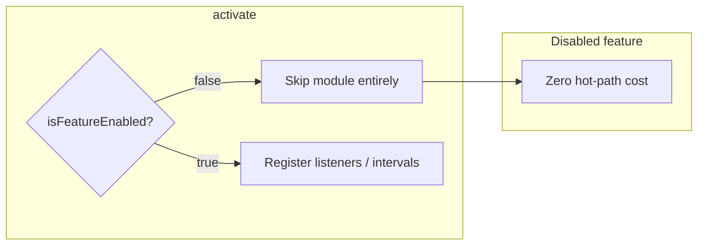

# Extension performance & kernel stability review

Review covered activation wiring in [`src/extension.ts`](src/extension.ts), feature defaults in [`src/util/featureFlags.ts`](src/util/featureFlags.ts), and hot paths that execute cells, mutate notebooks, or manage external Jupyter processes. Findings below are ranked by likelihood of disrupting **running kernels** or **editor responsiveness**.

---

## Hard invariant — disabled features must be free

**Requirement:** Any feature turned off via `jupyter-cell-tags.features.*` (or its migrated deprecated key) must impose **no meaningful editor/kernel cost**: no `onDidChangeNotebookDocument` / selection / scroll work, no intervals/polls, no command hijacks, no `applyEdit`, no process management, no decoration rebuilds.

**Accepted residual cost when disabled:** package.json command/menu contributions (VS Code resolves lazily) and a one-time `isFeatureEnabled` check at activate. Nothing that runs on typing, execution, or scroll.

### Current gating (good when off at activate)

These are skipped in [`src/extension.ts`](src/extension.ts) when `isFeatureEnabled(...)` is false — **no listeners registered** if the feature was off before activate/reload:

- `jumpbacks`, `outlineSync`, `customOutline`, `ringMeJupyter`, `notebookFilter`, `jupyterEnhancements`, `gitDiff`, `dependencyChain`, `durableKernel`

Reload is already required for those toggles (`RELOAD_REQUIRED_FEATURES` in [`featureFlags.ts`](src/util/featureFlags.ts)). After reload with the feature off, cost should be zero **if** activate never touches that module.

### Gaps that violate the invariant today

| Gap | Detail |
|-----|--------|
| **Scrollbar decorators** | [`ScrollbarDecoratorManager`](src/noteAllTags/scrollbarDecorators.ts) is always constructed from the tags tree. When `features.scrollbarDecorators` is false, `updateAllDecorations` early-returns, but **notebook-change and active-editor listeners still fire** on every edit/switch. Disable must dispose those listeners (or never construct the manager). |
| **cellHistory** | Always activated; **no** `features.*` key. Writes metadata on every keystroke regardless of settings. |
| **cellExecution tracking** | Always activated: “Cell finished!” toast + executed-cells view refresh on every execution — not feature-gated. |
| **Always-on core (not Features toggles)** | Tags tree, run groups, cell headings, navigation menu shell, selection status bar, cell metadata display — always register. Optimize separately; they are not “disabled features,” but anything expensive that *can* be toggled must use Features. |

### Enforcement approach (concrete)

1. **Activate-only wiring:** Keep the `if (isFeatureEnabled(...)) { activateX(context); }` pattern in [`extension.ts`](src/extension.ts). Never register hot-path listeners inside a feature module when the flag is false.
2. **Scrollbar:** Construct `ScrollbarDecoratorManager` only when enabled; on config disable, `dispose()` all listeners/decoration types and drop the instance (or re-create on enable after reload).
3. **Add Features settings** for currently ungated costly modules:
   - `jupyter-cell-tags.features.cellHistory` (default **false**)
   - `jupyter-cell-tags.features.cellExecutionTracking` (default **false** or keep tracking but gate **toasts**/heavy view refresh behind `showDebugExecutionMessages` / a Features key)
4. **No “enabled check inside hot handler” as the only gate** for expensive features: if disabled, the handler must not be subscribed. Early-return inside a subscribed handler is insufficient for this invariant.
5. **Verification checklist:** With all optional `features.*` set to `false` and window reloaded, confirm (via logging or a temporary probe) that no feature-owned `onDidChangeNotebookDocument` / `setInterval` / jupyter command hijack is active during typing and Run All.

---

## Critical — can disrupt kernels or freeze the editor

### 1. Stale `executionSummary` races sequential multi-cell runs
**Where:** [`src/jupyterEnhancements/extension.ts`](src/jupyterEnhancements/extension.ts) — `executeCellAndWaitNative` (~362–390), used by `runSequenceHandler`  
**Default on:** `features.jupyterEnhancements: true`  
**When off:** activate skipped — no hijacks (satisfies invariant after reload).

Poller resolves as soon as `cell.executionSummary?.success !== undefined`. That field is often **already set from a prior run**, so the waiter can finish before the new execution starts.

**Impact:** Run All / Below / Above can flood the kernel or stop early on stale failure.

**Fix:** Wait for a *new* execution via `onDidChangeNotebookCellExecutionState` or execution-order change. Do not treat a pre-existing `success` as completion.

### 2. Permanent override of native/Jupyter multi-cell commands
**Where:** same file ~98–102

Replaces `notebook.cell.executeCellAndBelow`, `notebook.cell.executeCellsAbove`, `jupyter.runCellAndAllBelow`, and especially `jupyter.runPrecedentCells` / `jupyter.runDependentCells`.

**Fix:** Stop overriding precedent/dependent commands; use dedicated extension commands or wait on execution-state events.

### 3. Per-keystroke metadata writes (always on, not feature-gated)
**Where:** [`src/cellHistory/cellHistoryTracking.ts`](src/cellHistory/cellHistoryTracking.ts); activated unconditionally in [`extension.ts`](src/extension.ts) ~89  
**Helper bug:** [`updateCellMetadata`](src/util/notebookMetadata.ts) shallow-clones then mutates nested objects.

**Impact:** Typing jank; cascade into every other notebook-change listener; violates “settings can turn off cost” because there is no setting.

**Fix:** Add `features.cellHistory` (default false); only `trackCellHistory` when enabled; debounce writes when on; deep-clone metadata.

---

## High — execution-time UI churn / process hazards

### 4. Notebook filter reapply during output streaming
**Where:** [`src/notebookFilter/startup.ts`](src/notebookFilter/startup.ts)  
**When off at activate:** no reapply listeners (OK). When on: reapply on every document change including outputs.

**Fix:** Ignore view-state/self-induced changes; settling window after apply.

### 5. Durable kernel: aggressive kill + fragile health
**Where:** [`DurableServerManager.ts`](src/externalKernel/DurableServerManager.ts)  
**When off:** activate skipped — no 5s health poll (OK after reload).

**Fix:** PID validation before `taskkill /T /F`; `--port-retries=0` or parse bound port; N failed probes before clearing managed state.

### 6. Hijack window allows concurrent executes
**Where:** JE `runSequenceHandler` / `runSingleHandler` — dispose hijack, execute, re-register; subscriptions stack.

**Fix:** Serialize execute; single disposable refs (no push-every-rewrap).

### 7. Tags tree + scrollbar decorations: undebounced full rescans
**Where:** tags tree always-on (core); scrollbar should be free when `features.scrollbarDecorators` is false (see invariant).

**Fix:** Debounce/throttle when enabled; when disabled, dispose manager entirely.

### 8. Git modified-cells: `git show` + O(n²) LCS on edits
**When off at activate:** no refresh listeners (OK). When on: content+output edits trigger work.

**Fix:** Content-only refresh; cancel in-flight; longer idle debounce.

### 9. Jupyter enhancements 200 ms idle poll
**When off:** interval never started (OK). When on: constant CPU.

**Fix:** Event-driven finished-cell UX only; remove forever poll.

---

## Medium — stability / UX noise

| Issue | Location | Notes |
|-------|----------|--------|
| Unconditional “Cell finished!” toast | [`cellExecution/startup.ts`](src/cellExecution/startup.ts) | Always on; gate via Features or `showDebugExecutionMessages` |
| Executed-cells uncanceled timeouts | `ExecutedCellsTreeDataProvider` | Coalesce; only when tracking feature on |
| Undebounced `setContext` + status-bar `log()` | `extension.ts`, `statusBar.ts`, `logging.ts` | Core path; quieter logging |
| Global notebook layout rewrites | JE `updateLayoutSettings` | Only when JE on |
| 5 min timeout does not cancel kernel | `executeCellAndWaitNative` | JE on only |
| Collection dispose leaks | `jupyterServerCollection.ts` | Durable kernel on only |

---

## Relatively safe / lower priority

- No kernel connection-file rewriting found.
- Jumpbacks / ringMe / cellMetadataDisplay: user-command or read-only when their modules are active.
- Outline sync debounced with loop guards when enabled.

---

## Recommended remediation order

1. **Disabled-feature invariant:** Audit every `features.*` path; fix scrollbar dispose-on-disable; add/gate `cellHistory` + cell-execution toast/view; verify all-features-off is quiet after reload.
2. **Kernel correctness:** Fix `executeCellAndWaitNative`; stop hijacking precedent/dependent; serialize hijack execute.
3. **Enabled-path costs:** Debounce cellHistory (when on); filter reapply guards; remove JE poll; debounce tags/scrollbar; gate git refresh.
4. **Durable kernel:** Probe hysteresis, port binding, safer kill.
5. **Hygiene:** Toasts, dispose leaks, hijack subscription stacking, selection logging.

**Safer defaults (optional):** Keep JE/filter/durableKernel defaults as today, but ensure turning them **off** is a reliable performance escape hatch (primary user requirement).

---

## Out of scope for this review

Runtime profiling under a live Jupyter session was not performed. After fixes, validate:

1. All optional `features.*` = `false` → type + Run All with no feature-owned notebook listeners/intervals.
2. Large notebook typing with only core tags enabled.
3. Run All with previously executed cells (JE on).
4. Active filter during long output (filter on).
5. Durable Start/Stop with port conflict and transient probe failure (durable on).
