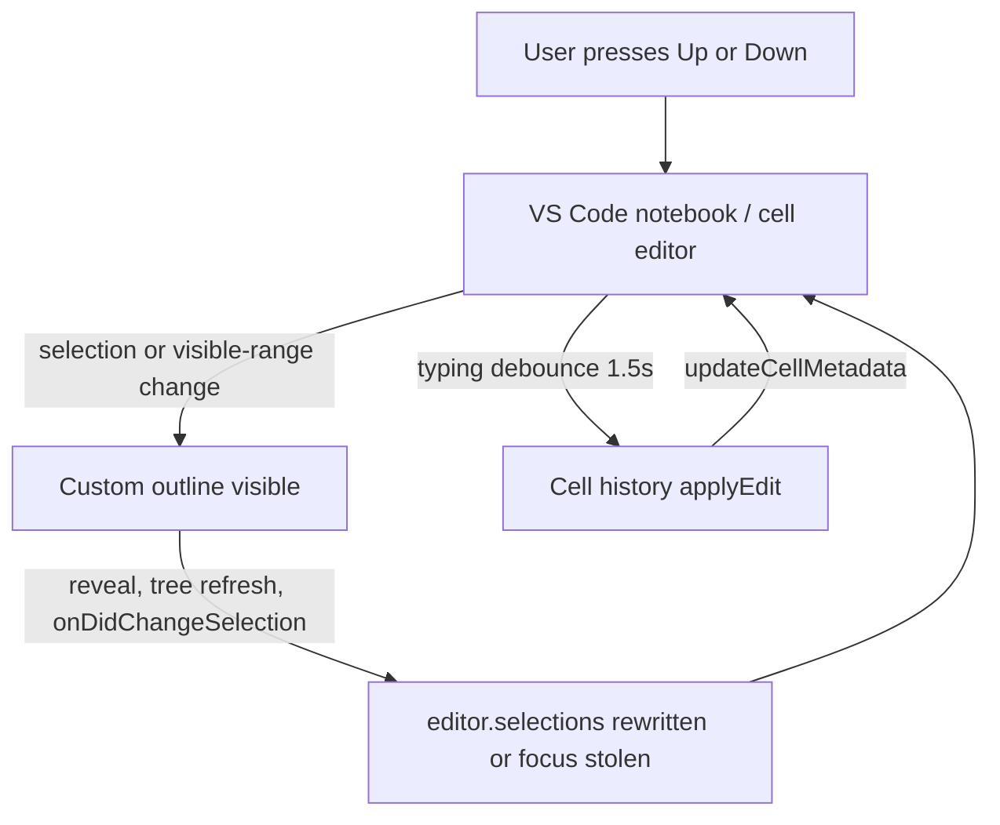

# Notebook Up/Down arrow review

This extension **does not bind `up`/`down`/`ArrowUp`/`ArrowDown`**, and it does not override `list.focusUp`, `list.focusDown`, `notebook.focusPreviousEditor`, or `notebook.focusNextEditor`. If arrows feel broken, it is almost certainly **indirect**: a selection rewrite, a focus steal, or a notebook `applyEdit` that drops the inner cell editor out of insert mode.

Native notebook behavior for context:

- Cell list / command mode: Up/Down = `list.focusUp` / `list.focusDown` (move between cells)
- Inside a cell editor: Up/Down = cursor movement
- Cursor on first/last line (with `notebook.navigation.allowNavigateToSurroundingCells`): Up/Down = `notebook.focusPreviousEditor` / `notebook.focusNextEditor`

All contributed keys live in [`package.json`](package.json) lines 1424–1460: heading depth (`ctrl+shift+[`/`]`), outline filter (`ctrl+f`/`escape` only when that view is focused), Shift+Enter / Ctrl+Enter execute wrappers, and F11 scratchpad. None of those are arrows.

## Ranked suspects

### 1. Custom outline selection/focus loop (highest)

On by default (`jupyter-cell-tags.features.customOutline`). This is the only always-on path that **writes `editor.selections` in response to ordinary notebook navigation**.

Feedback loop in [`src/customOutline/startup.ts`](src/customOutline/startup.ts) + [`src/customOutline/OutlineSelectionSync.ts`](src/customOutline/OutlineSelectionSync.ts) + [`src/customOutline/NotebookOutlineTreeDataProvider.ts`](src/customOutline/NotebookOutlineTreeDataProvider.ts):

- Arrowing a notebook changes selection and visible ranges.
- After debounce, `syncEditorToOutline` calls `treeView.reveal(item, { select: false, focus: false, expand: true })`. `TreeView.reveal` with `expand: true` has historically stolen focus even with `focus: false`. If the outline list takes focus, subsequent Up/Down navigate the tree, not the notebook.
- `treeView.onDidChangeSelection` then calls `syncOutlineToEditor`, which sets `editor.selections` to the **heading cell**, not the cell you were in. That feels like arrows jumping to the wrong cell or snapping back.
- Every `onDidChangeNotebookDocument` (typing, outputs, metadata) schedules `provider.refresh()` while the view is visible. Refresh rebuilds **new** `OutlineItem` instances and **does not set `TreeItem.id`**. Unstable identity often fires `onDidChangeSelection` and/or `TreeItem.command` on refresh.
- `OutlineItem.command` is `jupyter-cell-tags.customOutline.selectCell`, which both sets selection and `revealRange(..., AtTop)`. A spurious re-select yanks the viewport to the heading.
- Visible-range updates call `updateVisibleItems`, which mutates labels/icons (`👁 ...`) and fires `onDidChangeTreeData` per item as you move. That is another refresh source during arrow navigation.

If this is the cause: arrows work with the custom outline hidden; with it visible, selection snaps to a heading, the viewport jumps, or Up/Down starts moving the sidebar.

### 2. Outline sync `focusActiveEditorGroup` (high if custom outline fires it)

[`src/outlineSync/OutlineSyncManager.ts`](src/outlineSync/OutlineSyncManager.ts) runs `workbench.action.focusActiveEditorGroup` to refresh the built-in Outline. Manual arrows are supposed to skip this ([`src/outlineSync/startup.ts`](src/outlineSync/startup.ts) lines 73–80), but custom-outline `onDidChangeSelection` **calls `syncOutline` directly** after writing selections ([`src/customOutline/startup.ts`](src/customOutline/startup.ts) lines 84–91). That path is not gated on “user clicked the tree.”

`focusActiveEditorGroup` while you are inside a cell monaco editor typically **drops insert mode into command mode**. Then Up/Down move between cells instead of moving the cursor. Classic “arrows stopped working inside the cell.”

[`src/outlineSync/SelectionChangeDetector.ts`](src/outlineSync/SelectionChangeDetector.ts) uses a single boolean `programmaticChangeFlag`. A concurrent user arrow between `triggerSelectionChange` and the event handler can be misclassified as programmatic, which would also invoke the focus command.

### 3. Cell history metadata writes while typing (high if the feature is on)

[`src/cellHistory/cellHistoryTracking.ts`](src/cellHistory/cellHistoryTracking.ts) `applyEdit`s `cellEdited` metadata ~1.5s after cell document changes. Notebook metadata edits are a known way to disrupt the inner editor so Up/Down act as **cell** navigation.

[`package.json`](package.json) default is **true** (description even says it can dirty the notebook while typing). [`src/util/featureFlags.ts`](src/util/featureFlags.ts) fallback is **false**, but `config.get` uses the contributed package.json default, so this is **on for a default install**.

If this is the cause: arrows work until you pause typing for ~1.5s, then the cell editor loses insert focus.

### 4. Notebook filter collapse / sidebar focus (only when a filter is active)

[`src/notebookFilter/NotebookFilterManager.ts`](src/notebookFilter/NotebookFilterManager.ts) collapses non-matching inputs/outputs and reapplies on document changes. Collapsed cells change list Up/Down. [`src/notebookFilter/startup.ts`](src/notebookFilter/startup.ts) `notebookFilter.set` focuses `notebook-cell-filter-view`, which then owns Up/Down until the notebook is clicked again. Feature default is on; toolbar button is now hidden unless `toolbar.notebookFilter` is true.

### 5. Unrelated to idle arrows, but can look like “navigation is broken”

- **Shift+Enter / Ctrl+Enter** in [`package.json`](package.json) are always contributed, but handlers in [`src/cellExecution/cellExecutionTracking.ts`](src/cellExecution/cellExecutionTracking.ts) register only if `features.cellExecutionTracking` is on. If that feature is off, those chords can be swallowed. Not Up/Down.
- **Jupyter enhancements** hijack `notebook.cell.execute` / `notebook.execute` / execute-below/above and rewrite `editor.selections` during run sequences ([`src/jupyterEnhancements/extension.ts`](src/jupyterEnhancements/extension.ts) ~188–211, 393–460). Breaks execute-then-move, not idle arrows.
- Sidebar trees (tags, git diff, executed cells, jumpbacks, dependency chain) steal Up/Down **only when that view is focused**, and their `TreeItem.command`s jump notebook selection on click/Enter.

Recent uncommitted [`package.json`](package.json) / [`test-uri.js`](test-uri.js) changes are toolbar visibility and SVG URI encoding. They do not add arrow bindings.

## What I would change if you want a fix

Primary hardening, all in custom outline + outline sync:

- Guard `treeView.onDidChangeSelection` so it does **not** write notebook selections unless the outline view actually has focus (or the change came from a click/command).
- Stop calling `outlineSyncManager.syncOutline()` on every outline selection event; keep it for true programmatic jumps only.
- Give outline items a stable `TreeItem.id` so refresh does not re-fire selection/command.
- Avoid `reveal(..., { expand: true })` on every editor selection change; reveal without expand, or only when the item is not already visible. Never focus.
- Do not fire per-item `onDidChangeTreeData` from `updateVisibleItems` during arrowing (debounce, or restyle without recreating selection).
- Consider defaulting `features.cellHistory` to **false** to match [`FEATURE_DEFAULTS`](src/util/featureFlags.ts) and the “dirties while typing” warning.

## Quick isolation (no code)

Disable one feature at a time and retry Up/Down in a notebook cell:

1. `jupyter-cell-tags.features.customOutline` → reload
2. `jupyter-cell-tags.features.outlineSync` → reload
3. `jupyter-cell-tags.features.cellHistory` → reload
4. Confirm the custom outline / filter / tags views are not focused
