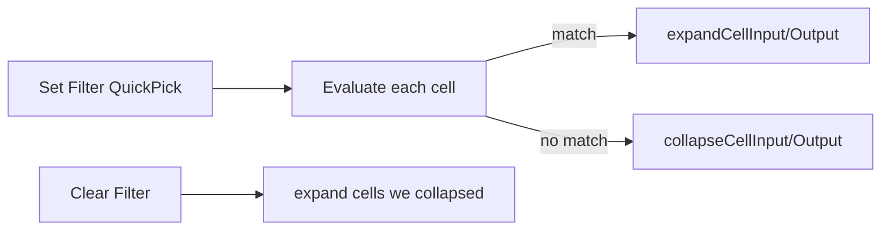

# Notebook Collapse Filter (Show Matches)

## Decisions locked in

- **Hide mechanism:** collapse non-matching cell inputs (and outputs when present) via `notebook.cell.collapseCellInput` / `collapseCellOutput` — same arg shape as existing execute calls in [`src/notebookRunGroups/util/cellActionHelpers.ts`](src/notebookRunGroups/util/cellActionHelpers.ts) and Jupyter’s own usage: `{ document: uri, ranges: [{ start, end }] }`.
- **Semantics:** show matches — expand matching cells, collapse the rest.
- **Criteria (v1):** tags, cell kind, has outputs, executed/not.
- **Hard constraints:** never call `NotebookEdit` / `WorkspaceEdit` for this feature; never write cell/notebook metadata; filter state lives only in extension memory.



## Matching model

New types in `src/notebookFilter/filterCriteria.ts`:

```ts
type NotebookFilterCriteria = {
  tags?: string[];           // if set/non-empty: cell must have ANY selected tag
  cellKind?: 'code' | 'markup';
  hasOutputs?: boolean;      // code cells: outputs.length > 0; markup treated as false
  executed?: boolean;        // true if executionSummary.executionOrder != null OR timing/success present
};
```

- Criteria fields that are unset are ignored.
- **AND** across field types; **OR** within `tags`.
- A filter is “active” when at least one field is set.
- Tag reads reuse [`getCellTags()`](src/helper.ts). Executed/outputs mirror patterns already used in [`src/cellExecution/cellExecutionTracking.ts`](src/cellExecution/cellExecutionTracking.ts) / [`src/exportExecutedCode/exportExecutedCode.ts`](src/exportExecutedCode/exportExecutedCode.ts).

## Core module: `src/notebookFilter/`

| File | Role |
|------|------|
| `filterCriteria.ts` | Types + `cellMatchesFilter(cell, criteria)` |
| `collapseCommands.ts` | Thin wrappers around collapse/expand input+output for index lists (batch contiguous ranges where helpful) |
| `NotebookFilterManager.ts` | Per-notebook URI state: active criteria, set of indices we collapsed, apply/clear/reapply |
| `filterQuickPick.ts` | Multi-step QuickPick UX to build criteria |
| `startup.ts` | Commands, context keys, listeners, toolbar wiring |

**`NotebookFilterManager.apply(notebook)`**

1. For each cell, evaluate `cellMatchesFilter`.
2. Non-matches → collapse input; if `outputs.length > 0`, collapse output. Record those indices in `collapsedByFilter`.
3. Matches → expand input (and output if present) so the focused set is readable.
4. Set context `jupyter-cell-tags.notebookFilter.active` and optional count key for UI.

**`clear(notebook)`**

1. Expand input/output only for indices in `collapsedByFilter` (avoid `expandAll*`, which would wipe user collapses unrelated to the filter).
2. Clear criteria + tracking; update context keys.

**Reapply**

- Debounced (~150ms, same pattern as other modules) on `onDidChangeNotebookDocument` while filter is active (tags/outputs/execution may change membership).
- On `onDidChangeActiveNotebookEditor`, re-sync context keys; filter is per-notebook URI so switching notebooks keeps each notebook’s filter independently.

No save hooks — collapse is view-state only and does not dirty the document when driven by commands (unlike metadata `inputCollapsed`).

## UX

**Commands** (contribute in [`package.json`](package.json)):

- `jupyter-cell-tags.notebookFilter.set` — “Filter Notebook Cells…”
- `jupyter-cell-tags.notebookFilter.clear` — “Clear Notebook Cell Filter” (`when`: filter active)

**QuickPick flow** (`filterQuickPick.ts`):

1. Multi-select tags from `getAllTagsFromActiveNotebook()` ([`src/util/notebookSelection.ts`](src/util/notebookSelection.ts)); allow skip (no tag constraint).
2. Cell kind: Code / Markdown / Any.
3. Has outputs: Yes / No / Any.
4. Executed: Yes / No / Any.
5. Apply; show brief status message e.g. `Showing 12/40 cells`.

**Toolbar** — add to existing `notebook/toolbar` group `navigation/execute@9` (after git-diff):

- Filter icon when inactive → runs `set`
- Clear / filled-filter icon when `jupyter-cell-tags.notebookFilter.active` → runs `clear`

**Status bar** (lightweight, optional but useful): when active, show `$(filter) N/M` with tooltip summarizing criteria; click clears or reopens set.

## Activation

In [`src/extension.ts`](src/extension.ts), call `activateNotebookFilter(context)` next to other feature startups.

Activation event: `onCommand:jupyter-cell-tags.notebookFilter.set` plus existing notebook activation paths already covering open notebooks.

## Out of scope

- Temporary `deleteCells` / remove-cell save-restore (contradicts non-destructive + kernel constraints).
- Writing collapse state into cell metadata.
- Exclude/factor-out mode (can add later as a criteria `mode` flag).
- Filtering side trees (outline already has its own text filter).

## Verification

- Open a notebook with mixed tags/kinds; set filter by tag → non-matching cells collapse, matches expand; document stays clean (not dirty from filter alone).
- Clear → previously filter-collapsed cells expand; unrelated user collapses left alone as much as possible.
- Change a cell’s tags while filter active → membership updates after debounce.
- Run a collapsed non-match via run-group/command still works (cells remain in the model/kernel).
