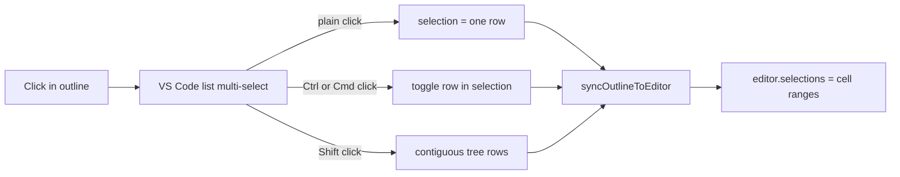

# Enable outline Ctrl/Shift multi-select

## Problem

[`createTreeView`](src/customOutline/startup.ts) already sets `canSelectMany: true`, and [`onDidChangeSelection`](src/customOutline/startup.ts) already calls `syncOutlineToEditor`. Multi-select still fails in practice because every row sets `TreeItem.command` → `jupyter-cell-tags.customOutline.selectCell`, which always syncs **only the clicked item** and fights native Ctrl/Cmd and Shift list selection.

```58:63:src/customOutline/models.ts
        this.command = {
            command: 'jupyter-cell-tags.customOutline.selectCell',
            title: 'Select Cell',
            arguments: [this]
        };
```

Same pattern on [`ExecutedCellLineItem`](src/customOutline/models.ts). Nested outline children are those executed-cell markers plus nested markdown headings.

## Approach

Keep notebook sync as **one cell range per selected tree row** (heading cell or executed cell). Section-wide select stays on the existing context command `customOutline.selectAllChildCells`.



### 1. Stop click commands from owning selection

In [`src/customOutline/models.ts`](src/customOutline/models.ts):

- Remove `this.command` from `OutlineItem` and `ExecutedCellLineItem`.
- Navigation/selection moves entirely to `treeView.onDidChangeSelection`.

Keep the registered `customOutline.selectCell` command in [`startup.ts`](src/customOutline/startup.ts) for palette/tests, but it must not be wired as a TreeItem click handler.

### 2. Sync all selected rows, including executed-cell children

Update [`OutlineSelectionSync.syncOutlineToEditor`](src/customOutline/OutlineSelectionSync.ts):

- Accept all `NotebookTreeItem`s (not only `OutlineItem`).
- Map `OutlineItem` → `NotebookRange(cellIndex, cellIndex + 1)`.
- Map `ExecutedCellLineItem` → same for its `cellIndex`.
- Deduplicate overlapping ranges, then set `editor.selections` via `SelectionChangeDetector` when available.
- Reveal the last selected item’s cell (`AtTop`) so plain click still navigates like today.

Update the `selectCell` command body so programmatic/test calls still select+reveal one item, without assuming tree multi-select.

### 3. Selection-change handler owns click UX

In [`startup.ts`](src/customOutline/startup.ts), keep:

```ts
treeView.onDidChangeSelection(async event => {
  if (selectionSync.isSyncingFromEditor()) return;
  await selectionSync.syncOutlineToEditor(event.selection);
});
```

Ensure reveal happens inside sync (or immediately after) so removing `TreeItem.command` does not lose scroll-to-cell on single click.

Leave editor→outline as reveal-only (`select: false`) so notebook caret moves do not wipe a Ctrl/Shift outline multi-selection.

### 4. Tests

Extend [`src/test/commands/outline.vscode.test.ts`](src/test/commands/outline.vscode.test.ts) (or a small unit test of sync mapping) to cover:

- `syncOutlineToEditor` with multiple `OutlineItem`s → multiple notebook ranges.
- Mix of `OutlineItem` + `ExecutedCellLineItem` → both cell indices selected.
- Existing `selectCell` single-item behavior still passes.

Host TreeView cannot easily drive real Ctrl/Shift clicks in unit tests; assert the selection→editor mapping that those modifiers produce via `onDidChangeSelection`.

## Out of scope

- Changing plain click to select full `childCellRange` (that remains context menu **Select All Child Cells**).
- Enabling `canSelectMany` on tags/executed/git trees.
- Wiring unused provider `selectItems` / `getSelectedItems`.