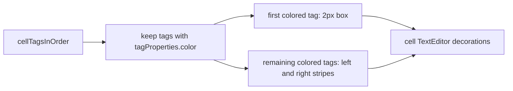

# Tag color cell borders

Optional visual, default **off**, using only **manually set** `tagProperties.color` (hex). Uncolored tags, hash fallbacks, and hot-age tree colors are ignored.

VS Code can only decorate the **cell input editor** (`vscode-notebook-cell`), not the outer cell chrome or outputs. That matches git-diff, jupyter enhancements, and the jump highlight.

## Visual rules

For each visible cell, take `getCellTags(cell)` in order and keep tags whose [`TagPropertiesManager.getTagProperties`](src/tagProperties/tagPropertiesManager.ts) entry has `color`.

- **First colored tag:** a 2px solid box around the cell editor, using first / middle / last line ranges so consecutive lines do not get a top+bottom “graph paper” look:
  - 1 line: all four sides
  - 2+ lines: top+left+right on line 0, left+right on middle lines, bottom+left+right on the last line
- **Additional colored tags:** extra 2px left **and** right stripes so every color stays visible. These cannot reuse `border` (it would overwrite the box), so they use per-line `before` / `after` attachments (`contentText: ' '`, `width: '2px'`, `backgroundColor`).
- No overview-ruler ticks (scrollbar markers already cover that).

## Feature wiring (pattern B, like scrollbar markers)

Self-managed hot toggle, **not** a `FeatureController` entry (no commands/views to unregister).

1. Add `tagColorCellBorders` to [`src/util/featureFlags.ts`](src/util/featureFlags.ts) (`FeatureKey`, `FEATURE_KEYS`, `FEATURE_DEFAULTS: false`, `FEATURE_SETTING_LABELS` matching package.json).
2. Contribute `jupyter-cell-tags.features.tagColorCellBorders` in the Features section of [`package.json`](package.json), default `false`, description aligned with the label (e.g. thin cell borders from each cell’s tag colors).
3. Turn the flag on in [`src/test/workspace/.vscode/settings.json`](src/test/workspace/.vscode/settings.json) and [`src/test/gui/wdio.conf.ts`](src/test/gui/wdio.conf.ts).

No extra width/side settings in v1 (fixed 2px). Git-diff / dependency-chain / jupyter left borders can still overlap the left edge; extras use injected bars so they do not steal the primary box’s `border`.

## New decorator module

Add [`src/noteAllTags/tagColorCellBorderDecorators.ts`](src/noteAllTags/tagColorCellBorderDecorators.ts), modeled on [`ScrollbarDecoratorManager`](src/noteAllTags/scrollbarDecorators.ts):

- `syncEnabledState()` on `jupyter-cell-tags.features.tagColorCellBorders`; attach/detach hot listeners; dispose types when off.
- Debounce ~200ms on `onDidChangeActiveNotebookEditor`, `onDidChangeVisibleTextEditors`, and `onDidChangeNotebookDocument`.
- Treat **notebook-level metadata** as a change (`e.metadata`), so `setTagColor` / `clearTagColor` refresh. Today [`notebookChangeMayAffectTags`](src/noteAllTags/scrollbarDecorators.ts) ignores that; this manager must not.
- Cache decoration types by `tag + color + kind` (`boxSingle` / `boxFirst` / `boxMiddle` / `boxLast` / `extraStripe`). Dispose and recreate when a tag’s color changes (avoid the scrollbar bug of caching by tag name only).
- Apply only to visible `vscode-notebook-cell` editors of the active jupyter notebook.

Export a small pure planner (no `vscode` types) for unit tests, e.g. `planTagColorBorders(tags, colorByTag)` and `boxLineRoles(lineCount)` → `'single' | { first, middle, last }`.

Construct the manager next to the scrollbar manager in [`register()`](src/noteAllTags/allNotebookTagsTreeDataProvider.ts) and `context.subscriptions.push` it. After `setTagColor` / `clearTagColor`, also call `scheduleUpdate()` on the border manager so a color edit is visible even if the metadata event is sparse.

## Docs and tests

- README Features bullet + CHANGELOG Unreleased note; mention the setting and that only tags with a set color get borders.
- Unit tests in `src/noteAllTags/tagColorCellBorders.test.ts` (cell tag order, skip uncolored, 1 vs many lines, extras). Add the compiled file to `package.json` `test:unit`.
- Host smoke in [`src/test/commands/tags.vscode.test.ts`](src/test/commands/tags.vscode.test.ts): with the flag on, set a tag color on a tagged cell and assert no throw (decorations are not inspectable). No FeatureController toggle test.

After implementation: `npm run test:unit`; `npm run compile`.
