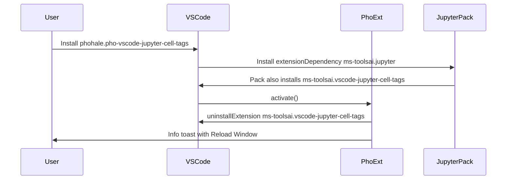

# Uninstall bundled Microsoft cell-tags

## Why this happens

[`package.json`](package.json) declares `extensionDependencies: ["ms-toolsai.jupyter"]`. Jupyter is an **extension pack** that also installs `ms-toolsai.vscode-jupyter-cell-tags`. VS Code installs that pack **before** this extension’s `activate()`, so the conflict is already present when we currently only detect it.

Today [`detect_conflicting_microsoft_extension`](src/helper.ts) shows an error and returns a boolean that [`src/extension.ts`](src/extension.ts) never uses:

```11:21:src/helper.ts
export function detect_conflicting_microsoft_extension(): boolean {
    const incompatible_extension = vscode.extensions.getExtension('ms-toolsai.vscode-jupyter-cell-tags');
    if (incompatible_extension) {
        const incompatible_message = 'Official Microsoft Jupyter Cell Tags extension ("ms-toolsai.vscode-jupyter-cell-tags") detected! Please manually uninstall...'
        vscode.window.showErrorMessage(incompatible_message);
        return true;
    }
```

## Behavior

Replace detect-only with uninstall-on-activate:

1. If `vscode.extensions.getExtension('ms-toolsai.vscode-jupyter-cell-tags')` is missing, no-op (host/GUI tests already omit or `--disable-extension` it).
2. Otherwise call the documented built-in:
   `vscode.commands.executeCommand('workbench.extensions.uninstallExtension', 'ms-toolsai.vscode-jupyter-cell-tags')`.
3. On success, show a non-blocking info toast with **Reload Window** (`workbench.action.reloadWindow`). Do **not** `await` the toast in `activate()` (that would stall the rest of activation until the user clicks). Do **not** auto-reload.
4. On failure, keep the current “uninstall it in the Extensions view” error as fallback.
5. Subscribe to `vscode.extensions.onDidChange` so a later Jupyter pack/VSIX install that brings the member back is uninstalled again. Marketplace *updates* of Jupyter normally do **not** reinstall an already-uninstalled pack member; this listener covers fresh pack installs. Guard with an in-flight promise so uninstall does not recurse.

There is no public disable API (`workbench.extensions.disableExtension` was declined). Uninstall is the supported path.



## Files

- [`src/helper.ts`](src/helper.ts): rename/replace the detector with `async uninstallConflictingMicrosoftExtension()`, export the extension id constant, return `'absent' | 'uninstalled' | 'failed'`.
- [`src/extension.ts`](src/extension.ts): `await` the uninstall at the start of `activate()`, then register `onDidChange` on `context.subscriptions`.
- [`README.md`](README.md): change “uninstall Microsoft Cell Tags **before** installing this one” to “this extension uninstalls the Microsoft Cell Tags pack member that ships with Jupyter; reload if prompted.”
- [`CHANGELOG.md`](CHANGELOG.md): add a 0.7.4 (or Unreleased) bullet. Manifest is already `0.7.4`.

## Tests / verification

- Host tests stay a no-op: [`src/test/runTest.ts`](src/test/runTest.ts) does not copy cell-tags and passes `--disable-extension=ms-toolsai.vscode-jupyter-cell-tags`.
- Run `npm run test:unit` after compile.
- Do not add a test that actually uninstalls extensions from the user’s or CI extensions directory.

## Out of scope

- Do not stop the rest of activation if uninstall fails (same as today).
- Do not publish a VSIX from this change.
