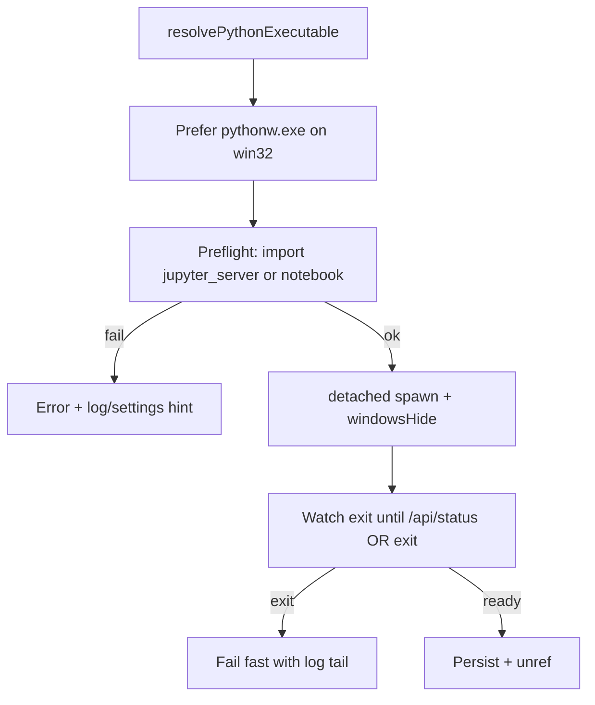

# Fix Windows Durable Jupyter Spawn

## Diagnosis

The brief CLI flash then disappear matches two Windows issues in [`DurableServerManager.ts`](src/externalKernel/DurableServerManager.ts):

1. **Console flash** — `detached: true` is required so libuv does **not** put the child in the Node kill-on-parent-exit Job Object (needed for EH survival). That path uses `DETACHED_PROCESS`, so `CREATE_NO_WINDOW` / `windowsHide` often still let `python.exe` (console subsystem) flash. Spawning `py.exe` / Store stubs makes this worse.
2. **Immediate exit** — the child almost certainly crashes (no `jupyter` / `jupyter_server` in the resolved env, or bad CLI args). Today we `unref()` immediately and only poll `/api/status`, so we miss the early `exit` and the user only sees a flash.

## Approach (locked)

Hardening only in [`src/externalKernel/DurableServerManager.ts`](src/externalKernel/DurableServerManager.ts) (+ small error text in [`startup.ts`](src/externalKernel/startup.ts) if needed). No API/UX redesign.

### 1. Windows executable selection

After resolving a runnable interpreter:

- If path ends with `python.exe` and sibling `pythonw.exe` exists, **spawn with `pythonw.exe`** (window subsystem → no console).
- Still use that env’s site-packages (same directory layout).
- Reject / skip Microsoft Store alias paths under `WindowsApps\python.exe` during candidate checks (they flash and are not real envs).

### 2. Preflight Jupyter before spawn

Run (hidden, short timeout):

`python -c "import jupyter_server"` → else `import notebook`

If both fail, throw immediately:

`Python at X has no Jupyter. Install jupyter_server in that env, or set jupyter-cell-tags.jupyterEnhancements.kernel.pythonPath to an env that already has it.`

Do not attempt a 60s wait when the module is missing.

### 3. Reliable Windows spawn + fail-fast exit watch

In `doStartManaged`:

- Prefer **`jupyter_server` first**, then `jupyter notebook` fallback.
- Drop empty `--NotebookApp.password=` / `--ServerApp.password=` flags (can confuse Windows argv parsing). Keep token + `--no-browser` / `ServerApp.open_browser=False`.
- Open log with `fs.openSync(logPath, 'a')` and pass that fd for stdout/stderr (reliable inheritance).
- Spawn options: `{ detached: true, windowsHide: true, stdio: ['ignore', out, out], shell: false }`.
- **Do not `unref()` until ready or failed.** Attach `child.on('exit')` so if the process dies during wait, fail immediately with exit code + **last ~40 lines of the log file** in the error (and Output channel).
- Only then `unref()` so the server outlives EH.

### 4. User-visible failure

If start fails, show the log-tail error in the existing notification/warning paths (`start` command / `selectKernel` auto-start). Offer **Show Durable Jupyter Log** so the flash is diagnosable without digging in globalStorage.

## Verification

1. Point `pythonPath` at an env **with** `jupyter_server` → Start Durable: no console flash (or negligible), status bar shows `Durable :port`, `/api/status` OK.
2. Point at an env **without** Jupyter → immediate clear error (no 60s hang, no mysterious flash-only failure).
3. After successful start: Restart Extension Host → server still up (rehydrate), notebook can reconnect via Durable collection.
4. Stop still kills only the managed PID via `taskkill /T /F`.
